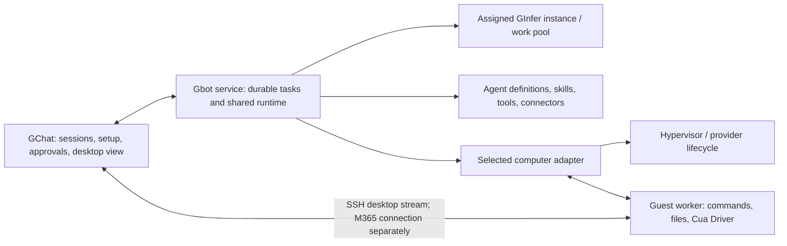

# Gbot design

Gbot is an embedded GChat feature: a persistent assistant that can use a separate
computer, shared agents, skills, tools and connectors. It also carries into paid
Arbitor. Its service runs on the user's own PC by default; owning a server is
not a prerequisite.

Status: Ron approved the design; it is merged into GChat main. October 11 step 1
implements the local-first service skeleton, vault-held SSH sessions, guest-tools
contract and SSH-tunnelled view channel. The approved S1 user-mode KVM preparation below replaces earlier S1/S2
acceptance-host proposals; the Debian image and Host tools are staged, with
first physical guest qualification pending.
The focused contracts and actual loopback SSH fixture pass;
No user desktop input or native Windows execution is authorized. Ron separately
approved the isolated S1 Debian guest and its harmless accessibility gate below.

## Decided product scope

| Area | First-release decision |
| --- | --- |
| Service location | Local PC, recommended; another PC on the LAN is the alternative. No cloud service location in v1. |
| Bot's computer | Separate local VM, another computer on the LAN, a user-rented cloud Debian 13 VM, or an existing M365 Cloud PC. |
| Local VM | Hyper-V on Windows; KVM on Linux. The bot never operates the user's own desktop through this option. |
| Cloud setup | Hetzner is the low-cost recommendation; DigitalOcean is the familiar US option. Both use provider API creation and the same cloud-init setup. Azure, AWS and GCP use guided setup. |
| Cloud guest | Debian 13, lightweight desktop environment (XFCE on TigerVNC Xvnc), session units, Cua MCP over SSH and SSH-only inbound access. No exposed VNC/RDP port. |
| Desktop view | Localhost VNC through SSH for local VMs and LAN/cloud computers; view-only by default, explicit Take over / Hand back. M365 uses its supported connection. |
| Sizing and price | Linux default 2 vCPU / 4 GB; 2 GB minimum. Read live regional prices and show monthly cost before creation. No fixed price or stale plan alias. Windows follows its OS requirements. |
| Persistence | Tasks, history and results survive service restart, PC sleep and client reconnect. Resume only after reconciling actual state. |
| M365 Cloud PC | Required first-release scope, not a later extension. Ron's existing Cloud PC is a development target. |
| Computer foundation | Pin Cua SDK and Driver to one source revision; use direct SSH on the LAN, without a cloud relay. |
| Credentials | GChat's native vault owns GChat-managed credentials; task records retain references, not secrets. |
| Development machines | Small Linux and Windows VMs on this desktop and S1 where their hypervisor supports them; Ron's running M365 Cloud PC. No machine is provisioned by this document. |

Each bot has its own name, computer, inference assignment and connector
settings; more than one bot is allowed. A new bot starts with **no connector
accounts**. Its mail/calendar/drive and other accounts are explicitly linked
and held in the vault under that bot's identity. It never automatically inherits
the user's GChat connector accounts. Agent, skill and tool definitions remain
shared, with one executor. These are decided requirements, not claims that
the per-bot connector UI is implemented.

Each bot gets its own sidebar channel next to Chat, Studio and Code. The bot
channel owns its conversation history, tasks, approvals and desktop view,
separate from ordinary model chats and Code sessions. Multiple bots retain
separate channels and assignments. This UI is planned, not delivered by the
workspace transport skeleton.

GChat remains the open base: front end, lightweight infrastructure management,
LAN host management, agent builder/support, prebuilt skills and integrations.
These decisions explicitly add user-owned cloud and M365 *bot computers* to Gbot;
they do not put the Gbot service in the cloud or turn GInfer LAN management into
a WAN service. GChat does not provide hosting, rent the VM on the user's behalf,
or introduce a mandatory account/relay subscription.

Arbitor adds its paid security, audit/logging, cost management and rules layers
through base extension points. Basic authenticated connections, permission
checks, lifecycle status and setup cost disclosure belong in GChat. No paid
policy engine, centralized audit system or spending controller is implemented
here. Exact release license, pricing and commercial limits remain separate
product decisions. GInfer CPU inference (OI-145) is unrelated to this design.

## A setup walkthrough for a novice

Enabling **Gbot** opens a guided walkthrough, rather than a collection of
technical connection fields. It asks two different location questions:

1. **Welcome:** explain that Gbot uses its own computer and can keep working
   after the GChat window closes. Choose a bot name and continue.
2. **Where should Gbot run?** **This PC** is recommended; **Another PC on my LAN**
   is the alternative. Describe the service as the part that remembers and runs
   tasks. The selected PC must be awake for work to progress.
3. **Where should the bot's computer be?** **Local VM**, **Another computer on my
   LAN**, **Cloud hosted**, or **M365 Cloud PC**. Explain the separate VM and the
   ongoing cloud cost in plain language.
4. **Check and prepare:** run the chosen path's checks, perform its approved
   setup automatically, and show stages such as Checking PC, Preparing computer,
   Connecting and Testing desktop. Ask for technical values only when discovery
   or account selection cannot supply them; keep an Advanced section available.
5. **Review:** name the service PC, bot computer, memory/disk allocation and
   inference assignment. For a new cloud VM, show the live monthly estimate and
   billable extras, and require **Create this computer** before making it.
   Explain any requested host elevation, restart or firmware action first.
6. **Ready:** show a real desktop frame and a harmless interaction, then offer
   a first task. If a prerequisite is missing, keep the setup resumable at that
   stage with one useful next action. Do not show Ready after only SSH login.

No default choice silently creates a VM or spends money. Installing/enabling a
hypervisor and any OS restart require the user's explicit action in this future
flow; a firmware setting cannot be fixed through an application dialog. A
supported existing hypervisor is detected and reused. Local VM setup exposes
normal disk use, VM removal and the difference between closing its view and
stopping its computer.

| Choice | Walkthrough checks and preparation | Failure presentation and recovery |
| --- | --- | --- |
| Service: This PC | Check platform, native vault and writable GChat data folder; install/register its per-user service, preserve shared definitions and credentials, test client reconnect. | Vault locked, insufficient disk or service unavailable: explain the cause and retry that stage. A service session unavailable after reboot is Waiting for sign-in. |
| Service: Another LAN PC | Discover or enter the PC, authenticate/pair it, check supported runtime and vault, and register the same service there. Keep state and credential references on that PC. | Offline, denied pairing or unsupported host: retain the choice and offer reconnect/change PC; no cloud relay fallback. |
| Bot PC: Local VM | Check Hyper-V/KVM, firmware virtualization, host resources and disk; help enable the selected hypervisor. Create a separate persistent guest, bootstrap its worker/session, establish SSH and test view/input. Windows guest setup also checks OS image, license and session readiness. | Unsupported Windows edition, disabled virtualization, pending reboot, unavailable KVM permissions, guest boot or worker failure: show the exact stage and next action. Never fall back to controlling the host desktop. |
| Bot PC: Another LAN computer | Discover or enter a dedicated computer/VM, confirm its desktop account and authority to install the worker, verify SSH identity, install/configure the worker and view endpoint with consent, test command/file/desktop access. | SSH unavailable, changed host identity, denied install, missing/locked desktop or blocked capture/input: stop that capability and guide reconnect, sign-in or authorized setup. Shell access alone is not Ready for GUI tasks. |
| Bot PC: Cloud hosted | Select provider/account/region; query live image/size/price/quota, show cost, then create owned Debian resources and run the shared first-boot setup. Test SSH, completed cloud-init, worker, desktop and viewer. | Expired credentials, quota/capacity, invalid quote, ambiguous creation, boot/provisioning or firewall failure: retain resource IDs, reconcile before retry, and offer repair or removal of this setup's resources. Never silently create a second VM. |
| Bot PC: M365 Cloud PC | Sign in through the supported Microsoft connection, select an assigned Cloud PC, check tenant permissions and desktop session, then qualify the chosen control route and takeover. No VM purchase is part of this path. | No assignment, MFA/conditional access, install/network policy, unavailable session or capture protection: explain the specific prerequisite and offer sign-in/admin assistance. Never bypass tenant controls. |

The service and computer may be on different machines. In that case setup checks
connectivity from the **service PC**, not just the GChat client. For a LAN service
with a VM local to the client, the VM is remote from the service: its guest SSH
route and host lifecycle adapter must both work. If that topology is unsupported,
explain it before creating a guest and offer moving the service or computer.

## Architecture and ownership

The Gbot service owns bot identity, task execution, history, schedules, working
memory, pending approvals and results. GChat is its client. Close/hide leaves
service-owned work active; **Quit Gbot service** is a separate action. A
per-user Windows service/agent or Linux user service is the proposed mechanism;
privileged installation helpers are separate from ordinary task execution.
No machine-level service is assumed able to capture a signed-in user's desktop.

The [existing agent runtime](../agent-runtime/README.md) and
[architecture](../../src-tauri/src/core/agent/ARCHITECTURE.md) share capabilities
across Chat, Studio and Code, but app exit currently cancels their execution.
Moving this ownership into the service is required implementation work, not a
capability obtained by connecting a VM. Use one definition/capability executor,
not a second set of Gbot skills or a separate provider-specific agent loop.

A computer adapter owns provisioning/attachment, lifecycle observations, commands,
files, desktop session identity and control. Cua handles qualified computer
mechanics; GChat owns setup, persistence, task semantics and the view/takeover
protocol. Keep local client files, service files and guest files explicitly
distinct in every tool call. A task assigned to a remote computer must not
silently use a client-machine file tool.

Inference assignments stay separate from computers. The guest does not need a
GPU, and a remote bot PC does not keep a local model running while its service
or inference workstation sleeps. The model runs on an assigned GInfer host/instance, never in the guest.
Screenshot reasoning requires a qualified Vision route; Vision is still
unqualified on the current artifacts (master OI-027/OI-029). Until qualification,
bot desktop work uses AT-SPI accessibility data, shell and files. The initial
Qwen screenshot study found 0–1000 normalized click coordinates even when pixels
were requested; a future Vision adapter must request that frame and convert
`x / 1000 * width`, `y / 1000 * height` before input
([study](/ai/coordination/vision-check/result.md)). A user can
view the desktop without claiming screenshot-driven model capability.
Do not silently change model context, step budgets or sampling on reconnect.

Client/service connections use authenticated local IPC or paired LAN TLS and
native credential storage, following GChat's existing identity/grant ownership.
A computer-control grant is explicit; an inference pairing is not automatically
permission to drive a desktop. Proposed extension boundaries allow Arbitor to
make policy decisions before task/action/provisioning, observe lifecycle events
for audit, and consume usage/billing observations for cost management. These
are interfaces to design, without implementing paid layers or a generic plugin
framework in this step.

## Cua foundation and direct transport

Pin the initial SDK/Driver evaluation to Cua monorepo revision
`0c69d9a2c8abbb5051a2df4a23f0fa166d5385dc`, identified by Driver release
`cua-driver-rs-v0.34.1`. Both selected components come from this revision; SDK
package versions are independent and must not be called 0.34.1 by inference.
The Linux guest selects the official binary-only release archive, SHA256
`a41fe2bdcbeea4501dc594c074f16b0975728e0cc7b08b90acea8564d48fafee`.
Only the MIT Driver and cursor helper are extracted; no optional Wayland
helpers or enterprise components are installed. This does not qualify Vision.
[Driver release](https://github.com/trycua/cua/releases/tag/cua-driver-rs-v0.34.1),
[pinned Driver](https://github.com/trycua/cua/blob/0c69d9a2c8abbb5051a2df4a23f0fa166d5385dc/libs/cua-driver/README.md),
[pinned SDK](https://github.com/trycua/cua/blob/0c69d9a2c8abbb5051a2df4a23f0fa166d5385dc/libs/cua/README.md).

Driver documents native capture/input and stdio MCP over SSH. The LAN route is
a direct SSH connection to the guest worker/desktop account, carrying its Driver
MCP process, with separate SSH command/file channels. The worker supplies the
selected session's X11 authorization, session D-Bus and accessibility environment;
an arbitrary SSH shell does not establish them. Reconnect verifies the same
workspace and live display before further input.
[Pinned Linux setup](https://github.com/trycua/cua/blob/0c69d9a2c8abbb5051a2df4a23f0fa166d5385dc/libs/cua-driver/rust/Skills/cua-driver/LINUX.md).

Use SDK lifecycle operations only for backends and components the pin actually
provides. Hyper-V/KVM and Hetzner/DigitalOcean provisioning adapters, Gbot's
session contract, durable tasks and Microsoft connection are GChat work; do not
label them existing Cua integrations. Neither a managed Cua account nor relay
is needed for direct LAN SSH.

SDK and Driver use MIT licensing at this pin; Spaces, relay and associated
viewer/streaming components have separate FSL terms. Select the MIT components
without silently pulling in Spaces or optional AGPL perception assets. The
GChat-owned SSH/VNC viewer's component licenses and exact versions must be
reviewed before dependency adoption; no viewer package is approved here.
[Pinned component licensing](https://github.com/trycua/cua/blob/0c69d9a2c8abbb5051a2df4a23f0fa166d5385dc/LICENSING.md).

## Local and LAN computers

Local means a **separate VM on the user's machine**, with persistent disk and a
bot desktop account. Check Hyper-V's supported Windows edition/virtualization
requirements or KVM availability before proposing activation. Choose a Linux
or Windows guest deliberately; Windows installation and minimum RAM follow its
OS contract, not the Linux 2 GB minimum. Hypervisor activation does not qualify
Cua capture, SSH or Windows session behavior.
[Hyper-V installation](https://learn.microsoft.com/en-us/windows-server/virtualization/hyper-v/get-started/Install-Hyper-V),
[KVM/libvirt setup](https://ubuntu.com/server/docs/how-to/virtualisation/libvirt/).

Attach existing LAN machines without reinstalling their OS. Bootstrap a dedicated
worker and selected graphical session only with the owner's approval; preserve
existing applications and files. Linux uses the same lightweight X11, session
D-Bus and accessibility contract as cloud guests. Windows uses a worker in its
intended logged-in session, with qualified capture/input and localhost-only view
transport. Windows login, lock, RDP disconnect and elevation have distinct effects;
never equate a live worker process with an available desktop.

## User-owned cloud computers

The automated paths create Debian 13 through the user's own provider account.
Hetzner's CPX-class choice is the low-cost recommendation, and DigitalOcean is
the familiar US alternative. Azure, AWS and GCP guide the user through the same
Debian/SSH requirements and attach the resulting machine; they do not promise
provider-specific automatic provisioning in v1.

Default Linux allocation is 2 vCPU / 4 GB, with 2 GB as the minimum option. Query
current availability and workload suitability, rather than guessing a plan name.
This is a setup default, not a browser/task performance claim. Show OS disk and
expected free space as well; do not silently resize or create extra billable
storage after approval.

| Provider | Live information and creation behavior |
| --- | --- |
| Hetzner | Join current server types/region availability with pricing, currency, VAT and Primary IP/storage/backups. Select a current CPX-class 2 vCPU / 4 GB plan if available; do not substitute another size without review. Create with Debian 13 image, SSH public key, first-boot user data, owned labels and firewall. |
| DigitalOcean | Enumerate available sizes and regions with vCPUs, memory in MB, disk, transfer and monthly/hourly price. Create the chosen Debian 13 Droplet with public key, user data and an owned tag bound to its prepared firewall. |
| Azure / AWS / GCP | Guided account, region, size and cost review; supply the shared first-boot specification and restricted SSH rules. Validate the resulting machine before attachment. |

At setup time, display the retrieved monthly estimate, currency, region, size,
quote time, included disk/traffic, taxes and separately billed items before
creation. Distinguish an estimate from a contractual billing cap. If a quote
expires or the selected plan changes, refresh it and ask again before creating.
Stopping a cloud VM is not the same as deleting billable resources; the UI must
show retained IPs/disks and expected continued charges. This cost disclosure is
part of setup, not Arbitor's paid cost-management product.
[Hetzner API schema](https://github.com/hetznercloud/hcloud-go/tree/main/hcloud/schema),
[Hetzner billing](https://docs.hetzner.com/cloud/billing/faq/),
[Primary IP billing](https://docs.hetzner.com/cloud/servers/primary-ips/faq/),
[DigitalOcean sizes](https://docs.digitalocean.com/reference/api/reference/sizes/),
[Droplet creation](https://docs.digitalocean.com/products/droplets/reference/api/droplets/),
[Droplet pricing](https://docs.digitalocean.com/products/droplets/details/pricing/).

Both automated providers use one first-boot cloud-init specification: install
TigerVNC Xvnc and XFCE, session D-Bus/accessibility, required applications, pinned
Driver, systemd user session units and same-session VNC. Use a persistent bot home and
owned session units; the dedicated bot desktop is separate from the host desktop. Fetch pinned packages without putting private API tokens, passwords
or SSH private keys in cloud-init. Provider credentials and generated private
keys stay in GChat's vault; user data receives only the necessary public key.

Prepare the provider firewall as part of creation and enable the guest firewall
before starting network services. Inbound access is SSH only, limited to the
approved service/client source networks. VNC binds localhost, never 0.0.0.0;
no public VNC or RDP ingress. Preserve the outbound DNS/HTTPS needed for setup
and applications: provider firewall defaults differ and must be explicit in each
adapter. Bind a prepared owned firewall before guest boot where supported.

Record created resource/action IDs durably before advancing. After a timed-out
create, reconcile this setup's exact labels/tags and operation records before
retrying. A provider's Running state is not successful provisioning: require
cloud-init success, authenticated SSH, a live worker, matching desktop capture,
and working tunnel/view before Ready. Offer repair or deletion of only this
setup's resources, leaving existing machines and retained user data alone.
[Cloud-init status](https://docs.cloud-init.io/en/latest/howto/status.html),
[DigitalOcean first-boot data](https://docs.digitalocean.com/products/droplets/how-to/provide-user-data/).

## View the desktop and take over

**View bot's desktop** opens an embedded GChat panel. For local VMs, LAN and
cloud computers, a VNC server in the bot session listens on localhost only.
SSH carries it to a loopback endpoint on the GChat viewer PC. A GChat-owned
local bridge adapts that stream to its embedded viewer; no cloud relay or
internet-facing browser/VNC endpoint is introduced. When the service is on a
separate LAN PC, the client opens its own authorized guest tunnel or a paired
service-forwarded channel; setup checks that route explicitly.

The frame shown and Driver input target must be the **same graphical session**,
with explicit display identity, geometry and scaling. Proposed viewer libraries
must demonstrate this contract rather than just showing any desktop.

| Control | Required observable behavior |
| --- | --- |
| View | Read-only. Opening a panel does not grant mouse, keyboard, clipboard or file-transfer input. |
| Take over | Service revokes bot input, the worker acknowledges that queued input is drained/cancelled, then human input is enabled. One owner controls this desktop. |
| Hand back | Human input ends; obtain a fresh frame/geometry and reconcile state before resuming the bot. |
| Connection loss | Disable input, show Offline, retain the task. Loss during takeover leaves it paused; do not silently hand the desktop back. |
| Close view | Close the viewer/tunnel without stopping the task, VM or service. Active human takeover requires explicit hand-back or remains paused. |
| Stop task | Stop its owned command processes and desktop input; preserve artifacts and report uncertain external actions. Do not stop other tasks' shared inference instance. |

Only one actor owns GUI input per desktop, including different clients and agents.
Independent shell/file tasks can run concurrently; concurrent GUI tasks need
separate qualified sessions/computers. Takeover may interrupt GUI actions but
must not claim to undo a submitted form, sent message or completed external call.

## M365 Cloud PC connection choice

Windows 365 is required in v1, but no control route is physically qualified yet.
Microsoft's supported access is Windows App or its web client using brokered RDP
connectivity and Microsoft Entra sign-in. A Cloud PC is not an ordinary public
3389 endpoint; adding SSH/VNC to it is not assumed. The broker is not a general
network tunnel for our worker. `mstsc.exe` is not the supported daily connection
path. [Supported access](https://learn.microsoft.com/en-us/windows-365/end-user-access-cloud-pc),
[connection model](https://learn.microsoft.com/en-us/windows-365/enterprise/understanding-remote-desktop-protocol-traffic),
[identity](https://learn.microsoft.com/en-us/windows-365/enterprise/identity-authentication).

| Route | Advantages | Requirements and trade-offs |
| --- | --- | --- |
| Drive a supported brokered RDP client from the LAN service PC | Reuses the user's normal Microsoft login/connectivity; no in-PC installation or new Cloud PC inbound port. | Qualify an actual supported client surface, viewport capture and coordinate mapping. Needs that client session on the service PC; lock/disconnect/capture policy can stop it. App-client embedding in GChat is not established by RDP protocol support. Shell/files may use supported redirection or another separately approved capability. |
| Install a bot worker in the Cloud PC's user session | Driver sees guest accessibility/session coordinates directly; command/file execution is owned inside the PC. | Requires tenant-approved installation plus an independently authenticated network path to the LAN service. Reverse-connect RDP does not supply that path. A Windows service in Session 0 cannot drive the user desktop. Sign-out, lock and tenant controls remain blockers; guest install is not proof of unattended operation. |

Recommendation: prefer the in-PC worker when installation and a direct approved
route are available, because it gives clear guest task/session ownership. First
probe Ron's actual policy and connectivity without changing them. If that route
is absent, qualify the supported brokered-client route instead; never invent a
public port or bypass a tenant rule. Choose the release route from that concrete
probe, including GChat's M365 desktop view and Take over / Hand back. A supported
external Microsoft client is an acceptable *development* probe, not proof that
the embedded product panel works.

Keep GChat-managed account/key/token material solely in its vault. Entra/SSO and
the supported Microsoft client own their normal OS authentication caches; do
not export their credentials into task state, prompts or saved RDP files. Tenant
MFA/conditional access and capture protection apply to both routes. Locked or
secure desktops, elevation prompts and protected input require authorized human
handling rather than an automation bypass. Reconnect/disconnect, lock, sign-out,
sleep and guest reboot each need an observed recovery case before qualification.
[Windows session services](https://learn.microsoft.com/en-us/windows/win32/services/interactive-services),
[capture protection](https://learn.microsoft.com/en-us/azure/virtual-desktop/screen-capture-protection),
[input integrity](https://learn.microsoft.com/en-us/windows/win32/api/winuser/nf-winuser-sendinput).

## Durable work and status

Persist task identity, originating conversation, definition revision, selected
computer/session, inference assignment, permissions, step/budget state, owned
process IDs, results and pending approvals on the service PC. Guest workers
retain enough operation identity to reconnect to their own long-running commands.
Closing the client cannot erase that state or transfer it to a different PC.

On sleep/network loss, park affected tasks and retain checkpoints. On restart,
recover records, unlock the vault as required, reconnect, inspect live commands
and desktop state, then resume from a known boundary. Queued schedules use an
explicit missed-run policy rather than replaying every missed event. Do not
blindly repeat an action whose external result is unknown; report **Needs review**
for ambiguous sends/submissions. Resume is persistence, not continuous execution
while the service PC or required model host is off.

Show bot sessions with the existing navigation, task progress/results/approvals,
and a computer status of Connecting, Ready, Paused, Offline, Waiting for sign-in
or Needs attention. Diagnostic detail stays expandable. Shared history and
compaction must preserve durable task state; compacting a model working set does
not delete the user's conversation or pending work.

## Implementation plan once separately authorized

1. Qualify pinned Driver capture/input, SSH command/file access and session-bound
   VNC viewing on a small Linux VM and a small Windows VM. Use this desktop and
   S1 according to actual hypervisor support; preserve existing host/model work.
   Test one harmless interaction, reconnect and takeover, not a broad benchmark.
2. Probe Ron's running M365 Cloud PC and select a viable supported route. Make
   its embedded view, capture/input, sign-in/disconnect and takeover work before
   claiming first-release coverage; do not postpone it behind cloud integrations.
3. Move shared agent execution into the local-first durable service, connect
   GChat, and verify one useful task survives client close, service restart and
   sleep/reconnect without duplicate external effects. Preserve shared definitions,
   capabilities, permissions, history and inference assignments.
4. Implement the novice walkthrough, Hyper-V/KVM adapters and LAN attachment;
   validate incomplete setup recovery and explicit VM ownership/removal.
5. Implement Hetzner and DigitalOcean using the shared Debian/cloud-init contract,
   with live cost review and resource reconciliation. Add guided Azure/AWS/GCP
   attachment and run the same desktop/session/control checks per path.

Each adapter must show a useful real task with an appropriate assigned model,
not only a shell connection. Release acceptance covers both service locations,
four computer choices, exact session capture/input, viewer/takeover exclusivity,
durable recovery, vault-only GChat secrets, and cost/resource cleanup. Platform
builds, actual cloud spend and Windows installation remain governed by Ron's
separate authorization and release schedule.

### Current SSH key import follow-up

Repository: GChat; subject: `docs/gbot/`. Current item is
`GBOT-SSH-KEY-IMPORT`, authorized October 11 at 18:15 UTC. Baseline is
main `c21ea4258`; candidate is branch `fix/gbot-ssh-key-import-c21` at
`/ai/gchat-worktrees/gbot-ssh-key-import-c21`.

Deliverable: import passphrase-encrypted OpenSSH keys and RSA keys through the
authenticated local service. Ask for the passphrase once at import, decrypt only
in memory and hold the usable key in the native vault. Workspace records retain
only its reference. Gbot-generated keys remain Ed25519; RSA is import only.
Missing/wrong passphrases and unavailable storage get typed errors without
returning secret data. Reconnect retrieves the vault key without a passphrase.

Named acceptance: one focused HTTP import/error/vault-only case; one actual
in-process SSH import/authentication/reconnect case; strict Clippy for the owning
crate. Existing unrelated passing checks are reused. No desktop, VM, provisioning,
model/GPU, native Windows or release/publication work is included. The exact
`russh` 0.63.1 RSA feature closure is approved; no unrelated dependency changes.
RSA selects SHA-2 signatures, never a silent SHA-1 fallback.

Tested source `11e08a67e` passes both named cases: HTTP import/error/vault-only
storage in 0.80 seconds, and encrypted Ed25519, encrypted RSA and plain RSA
import/authentication/reconnect in 2.81 seconds. The latter opens six fresh
connections using only vault references. Missing/wrong passphrases leave the
vault unchanged. Strict all-target Clippy passes. Evidence:
`/ai/gchat/out/gbot-ssh-key-import-20261011/result.json` and its three focused logs.
The server verifies RSA signatures and advertises SHA-2; its callback exposes
the authenticated key, without directly observing the wire signature hash.

The authenticated `POST /v1/credentials/ssh` accepts `private_key` and optional
`passphrase`, then returns `credential_ref` and comment-free `public_key` only.
It creates a fresh reference; callers cannot overwrite another vault entry.
`ssh_passphrase_required` and `ssh_invalid_passphrase` are 422 errors;
`ssh_invalid_key` is 400 and `ssh_vault_unavailable` is 503. The passphrase never
enters the vault or workspace state. Normalized usable key bytes enter only the
native vault. Input remains OpenSSH containers; other PEM/PPK formats are not
admitted by this slice. No key file or global SSH agent is used.

The approved feature adds only `rsa` 0.10.0-rc.18, `pkcs1` 0.8.0-rc.4 and
`crypto-primes` 0.7.2; existing locked package versions are unchanged. The RSA and
PKCS1 crates are release candidates. Recheck final versions before any GChat
release; do not change these pins during this source gate. See the
[credential decision](../decisions/2026-10-11-import-gbot-ssh-keys-through-native-vault.md).

The CPU booking ended at 18:26:19 UTC; the owned container is absent, generated
key files never existed, and the canonical build guard is returned. Shared
caches remain. Next action: reviewed main integration. Native vault providers
and physical guest/Windows/M365 behavior remain owed to their existing gates.

### Step 1: GChat workspace connection

October 11 implementation is **source-only until the development VMs exist**.
Ron approved the design and authorized a service skeleton, vault-held SSH
sessions, the guest-tools contract and an SSH-tunnelled view channel. The local
loopback fixture uses generated files and a synthetic view stream. S2 is Ron's
active desktop and must not be a bot target. No VM/cloud provisioning, worker
installation or desktop input is included.

The service owns persisted workspace records and operation reconciliation. It
does not introduce another agent executor. A service restart discards transport
handles; operations without a known outcome need reconciliation, not replay.
The existing shared agent runtime remains the execution owner.

Focused acceptance for this slice:

1. Persist and reopen a workspace with vault references only; reconcile an
   interrupted operation without repeating it or claiming a live connection.
2. Reject wrong workspace/session identities and unavailable guest capabilities;
   a remote failure never routes to local machine tools.
3. Verify native-vault failure handling and that keys cannot enter persisted
   records or diagnostic output.
4. Use one hermetic loopback SSH server to verify pinned identity, in-memory
   authentication, generated guest file/command operations, cancellation and
   disconnect. A wrong peer key must be refused.
5. Carry an echo stream over a guest-loopback-only SSH view channel; verify close
   and reconnect lifetime. This proves transport, not desktop capture or input.
6. Run focused crate checks and strict Clippy; no full product suite or model run.

The workstation has an SSH client but no SSH server. Ron approved `russh` 0.63.1
on October 11 at approximately 16:30 UTC for in-memory client authentication and
a hermetic server fixture. The service pins that exact version with its `ring`
backend. The library requires Rust 1.85; the service requires 1.89 for the shared
OS file lock that prevents two processes from owning its state. The selected
toolchain is 1.98. Fixtures must
demonstrate key authentication, exec/file transfer, cancellation, keepalive and
forwarding before this dependency is accepted for the slice. Credential import
now accepts plain or encrypted OpenSSH Ed25519, ECDSA and RSA keys, unlocks them
once and stores the usable key in the vault. The focused follow-up above closes
the earlier encrypted/RSA transport gap without a key-file or global-agent path.
Physical frame/input/takeover,
Windows and M365 gates await dedicated guests and Ron's release authorization.

The first implementation slice connects GChat to an existing, dedicated bot
computer and proves that commands, files, captured frames and input belong to
that computer's selected desktop session. Begin with one small Linux VM using
the pinned Cua Driver, then qualify the Windows VM and Ron's M365 Cloud PC.
Hypervisor/provider provisioning and durable task execution remain subsequent
slices; an attached computer does not establish either capability.

| Boundary | Proposed owner and behavior |
| --- | --- |
| GChat setup | Preserve the two location questions. Record the service PC separately from the bot PC, display connection stages and resume the unfinished choice from the existing GChat data folder. Local always identifies a separate VM, never the host desktop. |
| Connection record | Store the workspace ID, service location, transport endpoint, verified peer identity, selected desktop session and actual capabilities. Keep only vault references for credentials. Do not reuse an inference grant as desktop-control permission. |
| Workspace worker | Own guest command processes, guest paths and the selected graphical session. Use the pinned Driver for its qualified capture/input operations; report unavailable capabilities explicitly. A live SSH shell is not desktop readiness. |
| Shared runtime | Bind its file/command/computer tools to the selected workspace. Guest paths stay guest paths; a failed remote operation cannot fall back to a client-machine tool. Agent definitions and skills retain their existing shared ownership. |
| Desktop panel | Bind the displayed frame and input to the same session and geometry. Local/LAN/cloud use localhost VNC over SSH. Opening the panel is read-only; Take over waits for bot-input revocation before enabling human input. |

Connect in observable stages: verify the selected PC's identity and reachability
from the service PC; authenticate with vault-backed credentials; inspect the
worker and desktop session; obtain a real frame; verify an explicitly approved
harmless interaction; then expose Ready for those demonstrated capabilities.
For an existing LAN PC, missing worker/session components require an explicit
setup action rather than an implicit install. The initial development connection
uses a prepared guest and does not alter the user's own desktop or OpenCode
configuration.

An offline PC, changed SSH identity, locked vault, missing worker, unavailable
display or blocked capture/input keeps the setup at the failing stage with one
useful next action. On reconnect, verify the workspace and session again before
input. A command whose result is unknown is reconciled by its worker operation
identity rather than repeated. Loss during human takeover leaves the bot paused.
Closing the panel closes its stream, not the VM or service.

The M365 connection uses the separately qualified route above. Do not force SSH
or VNC onto a Cloud PC or represent its brokered RDP connection as our worker
transport. The first slice must retain this adapter boundary while its actual
tenant/session probe selects the route.

When implementation is authorized, its smallest gate is one focused case for
workspace/session binding and reconnect, plus one real prepared-guest connection
showing a frame, a harmless command/file operation, an approved input and
Take over / Hand back. Windows/M365 physical checks follow Ron's authorized
desktop windows. These gates establish connection behavior, not cloud setup,
unattended task persistence, model quality or release coverage.

The source-only SSH connection and initial operation-recovery contract are implemented
below. Next unresolved implementation choices are the viewer component/license
and M365's actual permitted route. Resolve them against the pinned component contracts before
adopting dependencies; no second agent executor or paid Arbitor layer is needed
for this slice.

## Remaining engineering choices

- M365's actual permitted route, client integration and embedded viewing surface.
- Dedicated-guest worker integration and the authenticated desktop viewer bridge.
- Exact local VM images, owned session boot policy and viewer components/licenses.
- Guest application packaging and reasonable OS-disk defaults for the first tasks.

Service default, first-release M365 scope, the four computer options, provider
ordering and the no-relay LAN route are decided; they are not open questions.

## Current record and inventory

Repository: GChat. Subject authority: `docs/gbot/README.md`; this replaces the
older `docs/gbot-design/README.md` path. The [October 11 decision](../decisions/2026-10-11-design-local-first-gbot-and-computer-setup.md)
supersedes the initial draft's unassigned-cloud scope without changing runtime
code. Approved design `9c8c3b8ca` is merged; current implementation baseline is
GChat main `254c0f8fd`; tested source remains `1a5771def`.

| Owner / host | Path | Purpose and retention |
| --- | --- | --- |
| GChat coordinator / local workstation | Branch `feat/gbot-workspace-connection-42d`, merged in main `254c0f8fd` | Clean, pushed source tree retired after ancestry verification; no live guest or service. |
| GChat coordinator / local workstation | `/ai/gchat/out/gbot-workspace-20261011/` | Focused gate and merged-tree retirement evidence; shared build cache retained. |
| GChat coordinator / local workstation | `/ai/gchat-worktrees/gbot-ssh-key-import-c21`, branch `fix/gbot-ssh-key-import-c21` | Tested import follow-up, retained until reviewed main integration; no live service or guest. |
| GChat coordinator / local workstation | `/ai/gchat/out/gbot-ssh-key-import-20261011/` | Two focused gate results, logs and dependency decision; no keys or model/VM copies. |
| GChat coordinator / local workstation | `/ai/gchat/out/gbot-design-20261011/` | Concise input/research and document-check evidence; no binary, model or VM copy. |

Deliverable: the local-first service skeleton, vault-backed SSH transport,
session-bound guest-tools contract and tunnelled view transport. Acceptance is
the focused step-1 cases above. Physical desktop readiness and unattended agent
execution are not established by this skeleton. The approved design's completed
review evidence remains in `/ai/gchat/out/gbot-design-20261011/`.
The service/contract/vault/SSH owners are composed. On October 11 the focused
gate passed 12 library cases and two actual SSH loopback cases. After correcting
the HTTP parser's oversized error return, its affected HTTP case and composed
SSH/HTTP case passed again; strict Clippy passed for all crate targets. Tested
source is `1a5771def`, from main `42d8c401e`; evidence is
`/ai/gchat/out/gbot-workspace-20261011/result.json` and its six focused logs.
The loopback fixture verifies pinned vault-key authentication, generated guest
command/file operations, cancellation, keepalive, forwarding and shutdown. A
lost reply followed by service restart reconciles one completed file effect
without dispatching it again. Native-vault provider availability remains
unqualified. The import follow-up above qualifies encrypted/RSA behavior against
the hermetic SSH server; it does not establish a physical vault provider.
The CPU booking ended at 16:48:48 UTC; owned containers and generated guest files
are gone and the canonical build guard was returned. The shared build cache is
retained. No existing desktop, model, profile or host configuration was a target.

Step 1 is merged. Dedicated-guest desktop capture/input,
takeover, Windows and M365 connection qualification await their approved guests.

The raw view tunnel is bidirectional transport. It must not be advertised as a
read-only desktop panel: VNC input/clipboard mediation and takeover exclusivity
remain part of the later dedicated-guest integration. A worker restart or unknown
operation ID cannot authorize replay of a possibly completed external effect.

### Current KVM and Linux desktop preparation

Repository: GChat; subject: `docs/gbot/`. Authority:
`/ai/coordination/gbot-vm-plan-20261011.md`, including approved stack and design
additions. Candidate `feat/gbot-kvm-cloud-init-c21`, baseline main `0705f31a6`,
at `/ai/gchat-worktrees/gbot-kvm-cloud-init-c21`. OI-057 package source remains
exact main `0705f31a6` in the separate owned tree
`/ai/gchat-worktrees/oi057-linux-packages-0705`; outputs/evidence are
`/ai/gchat/out/oi057-linux-packages-20261011`.

S1 (`ron@192.168.1.109`, verified AIS-2-8592-L01) has all seven explicitly
approved host packages: `qemu-system-x86`, `qemu-utils`, `cloud-image-utils`,
`libvirt-daemon`, `libvirt-daemon-driver-qemu`, `libvirt-clients`, `passt`.
KVM read/write access is intact; `libvirt-daemon-system` is absent and the
system libvirt services are inactive. SeaBIOS suffices; no bridge or host
firewall setup is part of this adapter.

The adapter uses **qemu:///session** with a passt user-mode interface and an
explicit loopback-only SSH forward. Libvirt owns the running guest independently
of Gbot service lifetime. Disks, seed, XML and setup records are under
`/ai/gbot-vms`; libvirt keeps normal per-user domain registrations. Unregister
the exact stopped owned UUID before deleting its files. Never remove other
users' domains or claim directory removal alone clears registration. Stop both
guests during CPU-throughput benchmarks on all or overlapping cores. Disjoint
GPU runs can coexist only with explicit guest vCPU/emulator pins. The first
guest is pinned to112–113 (coordinator clarification1954Z).

Two guests serve different purposes. `gchat-linux-accept` is stock Ubuntu 24.04
Desktop/GNOME, 4 vCPU / 8 GiB / 40 GiB, with a post-install clean snapshot.
OI-057 runs in both GNOME Wayland and Ubuntu on Xorg: launch/render, one Chat
completion through an accepted Host, generated session save/reopen across
restart, normal exit. `gbot-linux-dev` is a Debian 13 cloud image created by
the product adapter, 2 vCPU / 4 GiB, XFCE on Xvnc :1. VNC listens on localhost
and uses SSH. Neither guest shares a person's desktop or uses GPUs.

There is no new native guest-worker binary. Cloud-init and systemd **user**
units own Xvnc/XFCE, publish the selected DISPLAY/XAUTHORITY/session D-Bus
environment, and enable AT-SPI. The service runs pinned Cua Driver MCP over
SSH with that environment; commands and files use SSH channels. Per-session
identity and capability checks must stay intact while removing the initial
JSON-worker assumption. User viewer input/clipboard starts disabled. Actual
capture, input and takeover require their physical gates.

Named source gates: first-boot/session/SSH-only assertions, the KVM domain
XML/lifecycle fixture, strict owning Clippy. Libvirt source `91c0a7249` passes
2/2 focused cases and strict all-target Clippy; the opt-in guest gate builds
(`libvirt2-{fixtures,clippy,build}.log` in the evidence folder). This supersedes
the raw-QEMU prototype. DEB/AppImage and Manager archive are built from exact
main0705 with minimal archive inspection passed; see the package receipt.
They use cached Ubuntu24.04 tooling and the retained historical05a engine set:
current GChat UI/package acceptance only, no current-engine/Flash qualification.
No signing or publication.

Next action: create the one owned Debian guest on S1 in a finite CPU-quiet
window. Coordinator approved the first gate alongside the disjoint GPU timing run,
with guest vCPU/emulator affinity112–113. The unused slot1046 was cancelled;
a replacement finite slot covers the actual launch. No VM has launched yet. Gate: a real desktop frame plus one harmless AT-SPI action,
text-only; no screenshots fed to an unqualified model. Use official Linux
x86_64 Driver release0.34.1 at the pinned source revision with a recorded
SHA-256. Fall back from Xvnc only after a recorded failing action. Evidence and
owned runtime inventory: `/ai/gchat/out/gbot-kvm-prep-20261011/`.

The isolated first-guest fixture uses the owning KVM adapter and an isolated
native Secret Service collection. It generates an Ed25519 key in memory, stores
and reloads it through `NativeVault`, binds the SSH host key to the owned guest
console, and removes its credential when the gate ends. No key file or user
credential is copied. The guest is stopped before the CPU booking ends.
This qualifies guest setup/Cua at its stated scope; replacing the service's
merged `gbot-guest --stdio` assumption with Cua MCP and direct command/file
channels remains an explicit integration item, not a delivered Ready state.

Current owned S1 paths: `/ai/gbot-vms/images/debian-13-genericcloud-amd64-20261001-2618.qcow2`
(341508096 bytes, checked against official SHA512SUMS), the private
`controller/` native-vault fixture folder, `kvm-ready-fixture`, the reviewed
`s1-guest-gate.sh`, and `evidence/`. No VM/domain exists yet. Local temporary
Cua unpack and gate binary are retained for the pending physical gate;
retire them after qualification. No shared model, GPU profile or release
artifact was copied or deleted.

First physical preparation at1955Z refused the domain before VM start:
libvirt does not accept `console type=serial` as a character-device backend.
The adapter now uses `type=pty` with `target type=serial`. The fixture also
removes its vault entry after failed preparation, and the private keyring
control folder must be0700. Failed setup UUID
`fcb3271e-830e-40cb-b4c2-8ce170863f9f` remains stopped/unregistered for concise
failure evidence; no capture/input was attempted. Reuse the passing pin gates;
the corrected real libvirt define/start is the live question.

The corrected domain defined successfully at1958Z but the identity check
failed before start: real `virsh domuuid` accepts a domain name/ID, not a UUID,
while `domstate` does accept UUIDs. The adapter now looks up its generated owned
name and compares the returned UUID, retaining UUID-based actions. The fixture
models that real CLI distinction. Failed UUID
`d83415c6-ba2c-4a44-aaca-9915b167859d` was confirmed shut off; its fixture
credential cleanup succeeded. Undefine it before the corrected cold first-boot
attempt; retain concise XML/setup/error evidence and remove unused overlay/seed.
