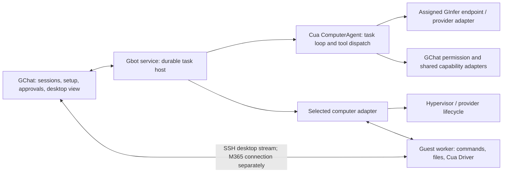

# Gbot design

Gbot is an embedded GChat feature: a persistent assistant that can use a separate
computer, shared agents, skills, tools and connectors. It also carries into paid
Arbitor. Its service runs on the user's own PC by default; owning a server is
not a prerequisite.

The accepted integration includes Cua native media and Ron's supplied avatar. The
service opens scoped view-only or human-controlled media sessions over the
existing vault-backed SSH connection. The browser receives a session ticket,
never the guest's root RPC token. Hand-back revokes the interactive stream
before resuming the bot. Focused UI, media lease and guest-install checks are
complete: UI 3/3, media policy/revocation 1/1 and guest installation 6/6
pass, together with frontend types and strict Rust Clippy. The pinned guest
daemon's cached container build and native/audio package passed. The audio-toggle
UI case and SSH reconnect/ownership regression also pass.
The physical Linux viewer gate passed: a real desktop frame, 440 Hz PCM tone,
view-only input refusal, takeover input and revocation on hand-back. The accepted
BGRA negotiation and seed provisioning fixes are merged in `2e735624f`; evidence
is linked in the current record below. Windows/M365 and browser playback remain
release checks. Rust 1.97 is required on Windows release hosts.

Current work implements the reconciled October 12 list. Opt-in visibility,
guided dedicated-LAN connection, transactional credential/workspace creation,
shared Chat workers and explicit per-bot Google/Microsoft accounts are merged
in main `8440b5f7a`. Bots inherit no accounts. Their focused service/native/UI,
lint, types, check and strict Clippy evidence is retained.

Main `13f88c042` includes resumable Linux KVM onboarding, pinned guest delivery,
independent service ownership and schedules. Settings enablement opens guided
setup. The wizard checks prerequisites and pinned assets, persists setup identity,
and admits a bot only after SSH, desktop-file and view-only media readiness.
Focused service, adapter, wizard and native-route cases, frontend types, native
check and strict Clippy pass. These establish source behavior; packaged
bootstrap, native vault, client-exit/sleep and live scheduled dispatch still need
installed checks.

The dedicated VM gate found an archive-symlink seed defect; the merged repair
embeds the exact pinned bytes. Readiness diagnostics then identified obsolete
keyboard arguments in the setup owner. The correction uses the Cua adapter's
current foreground-input contract and passes one focused case, check and strict
Clippy. The same persisted S1 guest reached Ready after service restart/resume:
editor input/save, independent file readback and view-only media passed. A real
isolated Chromium form also passed navigate/type/submit with exact independent
SSH readback. The temporary guest and private roots are retired. Evidence:
`out/gchat-open-items-20261012/readiness-input/` and `readiness-physical/`.
These qualify the Linux API owner; installed wizard presentation, packaged
bootstrap, Hyper-V/cloud/M365 creation and remote service selection remain
unfinished. The [implementation and test plan](../agent-runtime/remaining-acceptance.md#current-implementation-and-test-plan--october-12)
separates source gaps, accepted evidence and remaining gates.

Ron selected **Cua native media for the first release** on October 12. Adopt
its Spaces guest media endpoint and browser media core through SSH; retain
GChat's task, vault and control owners. The [Cua map](cua-map.md#viewer-options-for-ron)
records the closure, notices and remaining checks. The existing Xvnc/XFCE guest
remains the desktop backend. No noVNC/websockify viewing transport is selected.

Bot channels, browser/control bindings and the accepted Linux Cua runtime are
merged in `45ac4ae7e`. Their six focused cases, strict service Clippy, native
type check and frontend types/lint pass. Evidence:
`out/gbot-cua-guest-20261012/result.json` and
`out/gbot-cua-runtime-20261012/result.json`.
Compact output is merged in `9ab394244`.
Ron selected Cua for the agent framework while retaining our VM provisioning,
Hyper-V and M365 Cloud PC connection. GChat retains durable state, vault,
approvals, sessions and inference assignment. The service boundary retains approvals and saved effect receipts; Cua owns task
iteration.

The local-first service, vault-backed SSH/Cua transport and dedicated Debian
guest are implemented. The production Cua executor is merged in `7672fb060`.
The SDK base remains `0c69d9a2c8`; the reviewed Driver fork is now
`c549ab4d7`, which preserves visible untitled transient/modal windows and marks
the active modal. Eight focused visibility cases, the compatible Ubuntu 24
Driver build, the example build and strict Clippy pass.

Exact desktop executor acceptance passes: the single seeded overwrite task
observed the nested Replace confirmation, clicked Replace and saved exactly
16 bytes, `Hello from Gbot.`, verified independently by SSH. The owning Driver
fix is pushed; model settings, input guards and the exact-byte oracle are
unchanged. Both actual Cua `hello_file_env` variants already passed with reward
1.0 on Ada Qwen SMOL, 262144 context; their evidence is reused.

The provider leaves Qwen sampler defaults intact, including presence penalty
1.5; the approved greedy launch changes temperature to 0. The test guest used
only reserved S1 cores 112–113. Its domain, disk and native-vault key are now
retired; the model stopped normally and both bookings were released. No human
desktop input, native Windows execution or new Python sandbox/dataset closure
was used. This acceptance covers the tested text-only desktop task, not Vision
or performance.

## Decided product scope

| Area | First-release decision |
| --- | --- |
| Service location | Local PC, recommended; another PC on the LAN is the alternative. No cloud service location in v1. |
| Bot's computer | Separate local VM, another computer on the LAN, a user-rented cloud Debian 13 VM, or an existing M365 Cloud PC. |
| Local VM | Hyper-V on Windows; KVM on Linux. The bot never operates the user's own desktop through this option. |
| Cloud setup | Hetzner is the low-cost recommendation; DigitalOcean is the familiar US option. Both use provider API creation and the same cloud-init setup. Azure, AWS and GCP use guided setup. |
| Cloud guest | Debian 13, lightweight desktop environment (XFCE on TigerVNC Xvnc), session units, Cua MCP over SSH and SSH-only inbound access. No exposed VNC/RDP port. |
| Desktop view | Cua native media over SSH for local VMs and LAN/cloud computers; view-only by default, explicit Take over / Hand back, with desktop audio from Cua. M365 uses its separately qualified connection. |
| Sizing and price | Linux default 2 vCPU / 4 GB; 2 GB minimum. Read live regional prices and show monthly cost before creation. No fixed price or stale plan alias. Windows follows its OS requirements. |
| Persistence | Tasks, history and results survive service restart, PC sleep and client reconnect. Resume only after reconciling actual state. |
| M365 Cloud PC | Required first-release scope, not a later extension. Ron's existing Cloud PC is a development target. |
| Computer foundation | Pin the Cua SDK base and reviewed Driver fork revisions explicitly; use direct SSH on the LAN, without a cloud relay. |
| Credentials | GChat's native vault owns GChat-managed credentials; task records retain references, not secrets. |
| Development machines | Small Linux and Windows VMs on this desktop and S1 where their hypervisor supports them; Ron's running M365 Cloud PC. No machine is provisioned by this document. |

Each bot has its own name, computer, inference assignment and connector
settings; more than one bot is allowed. A new bot starts with **no connector
accounts**. Its mail/calendar/drive and other existing accounts are explicitly
linked by account ID; credentials stay with the shared native account vault.
It never automatically inherits the user's GChat connector selection. Agent,
skill and tool definitions remain shared. The merged account picker and
scoped executor boundary are implemented; live OAuth still needs app registration.

Gbot appears in the left menu **above Work**, only when Gbot integration is
enabled in GChat. Ron wants a ChatGPT DOT/Grok-style bot experience, adapted to
GChat's dark theme. Each bot uses the animated avatar supplied in `/ai/gchat/avatar`, with
light/dark styling and reduced-motion support. Detailed channel layout and the
guided setup remain separate UI work.

Each bot retains a separate channel for conversation history, tasks, approvals
and desktop view; multiple bots keep separate channels and assignments. The
current functional channel supplies SSH key import, connection controls, saved
brain settings, task history, approvals and takeover controls. The embedded media panel is merged in `e3ff85e8a`. Guided
VM/cloud setup and the final bot UI remain open. The candidate includes the
per-bot connector picker and guided dedicated-LAN connection.

GChat remains the open base: front end, lightweight infrastructure management,
LAN host management, agent builder/support, prebuilt skills and integrations.
These decisions explicitly add user-owned cloud and M365 *bot computers* to Gbot;
they do not put the Gbot service in the cloud or turn GInfer LAN management into
a WAN service. GChat does not provide hosting, rent the VM on the user's behalf,
or introduce a mandatory account/relay subscription.

Arbitor adds its paid security, audit/logging, cost management and rules layers
through base extension points. Basic authenticated connections, permission
checks, lifecycle status and setup cost disclosure belong in GChat. No paid
policy engine, centralized audit system or spending controller is implemented
here. Exact release license, pricing and commercial limits remain separate
product decisions. GInfer CPU inference (OI-145) is unrelated to this design.

## A setup walkthrough for a novice

Enabling **Gbot** opens a guided walkthrough, rather than a collection of
technical connection fields. It asks two different location questions:

1. **Welcome:** explain that Gbot uses its own computer and can keep working
   after the GChat window closes. Choose a bot name and continue.
2. **Where should Gbot run?** **This PC** is recommended; **Another PC on my LAN**
   is the alternative. Describe the service as the part that remembers and runs
   tasks. The selected PC must be awake for work to progress.
3. **Where should the bot's computer be?** **Local VM**, **Another computer on my
   LAN**, **Cloud hosted**, or **M365 Cloud PC**. Explain the separate VM and the
   ongoing cloud cost in plain language.
4. **Check and prepare:** run the chosen path's checks, perform its approved
   setup automatically, and show stages such as Checking PC, Preparing computer,
   Connecting and Testing desktop. Ask for technical values only when discovery
   or account selection cannot supply them; keep an Advanced section available.
5. **Review:** name the service PC, bot computer, memory/disk allocation and
   inference assignment. For a new cloud VM, show the live monthly estimate and
   billable extras, and require **Create this computer** before making it.
   Explain any requested host elevation, restart or firmware action first.
6. **Ready:** show a real desktop frame and a harmless interaction, then offer
   a first task. If a prerequisite is missing, keep the setup resumable at that
   stage with one useful next action. Do not show Ready after only SSH login.

No default choice silently creates a VM or spends money. Installing/enabling a
hypervisor and any OS restart require the user's explicit action in this future
flow; a firmware setting cannot be fixed through an application dialog. A
supported existing hypervisor is detected and reused. Local VM setup exposes
normal disk use, VM removal and the difference between closing its view and
stopping its computer.

| Choice | Walkthrough checks and preparation | Failure presentation and recovery |
| --- | --- | --- |
| Service: This PC | Check platform, native vault and writable GChat data folder; install/register its per-user service, preserve shared definitions and credentials, test client reconnect. | Vault locked, insufficient disk or service unavailable: explain the cause and retry that stage. A service session unavailable after reboot is Waiting for sign-in. |
| Service: Another LAN PC | Discover or enter the PC, authenticate/pair it, check supported runtime and vault, and register the same service there. Keep state and credential references on that PC. | Offline, denied pairing or unsupported host: retain the choice and offer reconnect/change PC; no cloud relay fallback. |
| Bot PC: Local VM | Check Hyper-V/KVM, firmware virtualization, host resources and disk; help enable the selected hypervisor. Create a separate persistent guest, bootstrap its worker/session, establish SSH and test view/input. Windows guest setup also checks OS image, license and session readiness. | Unsupported Windows edition, disabled virtualization, pending reboot, unavailable KVM permissions, guest boot or worker failure: show the exact stage and next action. Never fall back to controlling the host desktop. |
| Bot PC: Another LAN computer | Discover or enter a dedicated computer/VM, confirm its desktop account and authority to install the worker, verify SSH identity, install/configure the worker and view endpoint with consent, test command/file/desktop access. | SSH unavailable, changed host identity, denied install, missing/locked desktop or blocked capture/input: stop that capability and guide reconnect, sign-in or authorized setup. Shell access alone is not Ready for GUI tasks. |
| Bot PC: Cloud hosted | Select provider/account/region; query live image/size/price/quota, show cost, then create owned Debian resources and run the shared first-boot setup. Test SSH, completed cloud-init, worker, desktop and viewer. | Expired credentials, quota/capacity, invalid quote, ambiguous creation, boot/provisioning or firewall failure: retain resource IDs, reconcile before retry, and offer repair or removal of this setup's resources. Never silently create a second VM. |
| Bot PC: M365 Cloud PC | Sign in through the supported Microsoft connection, select an assigned Cloud PC, check tenant permissions and desktop session, then qualify the chosen control route and takeover. No VM purchase is part of this path. | No assignment, MFA/conditional access, install/network policy, unavailable session or capture protection: explain the specific prerequisite and offer sign-in/admin assistance. Never bypass tenant controls. |

The service and computer may be on different machines. In that case setup checks
connectivity from the **service PC**, not just the GChat client. For a LAN service
with a VM local to the client, the VM is remote from the service: its guest SSH
route and host lifecycle adapter must both work. If that topology is unsupported,
explain it before creating a guest and offer moving the service or computer.

## Architecture and ownership

The Gbot service owns bot identity, execution lifetime, history, schedules,
working memory, pending approvals and results; Cua owns task iteration and
tool dispatch. GChat is its client. Close/hide leaves
service-owned work active; **Quit Gbot service** is a separate action. A
per-user Windows service/agent or Linux user service is the proposed mechanism;
privileged installation helpers are separate from ordinary task execution.
No machine-level service is assumed able to capture a signed-in user's desktop.

The [existing agent runtime](../agent-runtime/README.md) and
[architecture](../../src-tauri/src/core/agent/ARCHITECTURE.md) share capabilities
across Chat, Studio and Code, but app exit currently cancels their execution.
Gbot will host Cua through the same definition/capability and permission owners;
this does not move or replace ordinary Chat/Studio/Code execution. Service
durability is required integration work, not a capability obtained by connecting
a VM or recording a Cua trajectory. The [component map](cua-map.md) replaces
the earlier custom Gbot-loop plan.

A computer adapter owns provisioning/attachment, lifecycle observations, commands,
files, desktop session identity and control. Cua handles qualified computer
mechanics; GChat owns setup, persistence, task semantics and the view/takeover
protocol. Keep local client files, service files and guest files explicitly
distinct in every tool call. A task assigned to a remote computer must not
silently use a client-machine file tool.

Inference assignments stay separate from computers. The guest does not need a
GPU, and a remote bot PC does not keep a local model running while its service
or inference workstation sleeps. The model runs on an assigned GInfer host/instance, never in the guest.
Screenshot reasoning requires a qualified Vision route; Vision is still
unqualified on the current artifacts (master OI-027/OI-029). Until qualification,
bot desktop work uses AT-SPI accessibility data, shell and files. The initial
Qwen screenshot study found 0–1000 normalized click coordinates even when pixels
were requested; a future Vision adapter must request that frame and convert
`x / 1000 * width`, `y / 1000 * height` before input
([study](/ai/coordination/vision-check/result.md)). A user can
view the desktop without claiming screenshot-driven model capability.
Do not silently change model context, step budgets or sampling on reconnect.

Client/service connections use authenticated local IPC or paired LAN TLS and
native credential storage, following GChat's existing identity/grant ownership.
A computer-control grant is explicit; an inference pairing is not automatically
permission to drive a desktop. Proposed extension boundaries allow Arbitor to
make policy decisions before task/action/provisioning, observe lifecycle events
for audit, and consume usage/billing observations for cost management. These
are interfaces to design, without implementing paid layers or a generic plugin
framework in this step.

## Cua foundation and direct transport

Pin the initial SDK/Driver evaluation to Cua monorepo revision
`0c69d9a2c8abbb5051a2df4a23f0fa166d5385dc`, identified by Driver release
`cua-driver-rs-v0.34.1`. Both selected components come from this revision; SDK
package versions are independent and must not be called 0.34.1 by inference.
The current guest selects our patched Driver at fork revision
`199e92644bdfd7d76066b3c2964fe43e9e84a67e`, built with the unchanged locked
closure on Ubuntu 24 (maximum GLIBC requirement 2.39). The compressed archive
SHA-256 is `0a12206990d2e72a77f7ef8f0b6c56c5a71b498984851878caefc6ffef6497b9`;
Driver binary SHA-256 is
`5d53b44878d3de7a514179b2f41ad1e6041258c1e528518052f32b10e1973f31`.
Its unchanged cursor helper comes from the original official archive, SHA-256
`a41fe2bdcbeea4501dc594c074f16b0975728e0cc7b08b90acea8564d48fafee`.
A local artifact is embedded in cloud-init; an HTTPS artifact uses the same
checksum and extraction contract. Both verify SHA-256 before extraction.
Driver updates provision a fresh guest with a new vault key through our adapter,
then retire the superseded guest; they do not patch a running guest.
Only the MIT Driver and cursor helper are extracted; no optional Wayland
helpers or enterprise components are installed. This does not qualify Vision.
[Driver release](https://github.com/trycua/cua/releases/tag/cua-driver-rs-v0.34.1),
[pinned Driver](https://github.com/Gadflyii/cua/blob/0c69d9a2c8abbb5051a2df4a23f0fa166d5385dc/libs/cua-driver/README.md),
[pinned SDK](https://github.com/Gadflyii/cua/blob/0c69d9a2c8abbb5051a2df4a23f0fa166d5385dc/libs/cua/README.md).

Driver documents native capture/input and stdio MCP over SSH. The LAN route is
a direct SSH connection to the guest worker/desktop account, carrying its Driver
MCP process, with separate SSH command/file channels. The worker supplies the
selected session's X11 authorization, session D-Bus and accessibility environment;
an arbitrary SSH shell does not establish them. Reconnect verifies the same
workspace and live display before further input.
[Pinned Linux setup](https://github.com/Gadflyii/cua/blob/0c69d9a2c8abbb5051a2df4a23f0fa166d5385dc/libs/cua-driver/rust/Skills/cua-driver/LINUX.md).

Keep our libvirt-session/KVM and Hyper-V lifecycle, Debian cloud-init,
Hetzner/DigitalOcean adapters and M365 connection. Cua SDK sandboxes are not
adopted as a second lifecycle owner. Borrow guest packages/settings where useful;
adopt Cua's agent, Driver and tools above that layer. Neither a managed Cua
account nor relay is needed for direct LAN SSH.

SDK, Driver and agent core use MIT licensing at this pin; selected Spaces,
viewer and media components have FSL terms. Ron permits FSL viewer/media for
GChat; they remain excluded from paid Arbitor pending his review. Optional
AGPL perception assets are excluded. Check each selected component's LICENSE
and dependency closure before shipping. Cua native media is the selected viewer;
Linux capture/audio and control pass on the dedicated guest; Windows/M365 and
browser playback remain release gates.
[Pinned component licensing](https://github.com/Gadflyii/cua/blob/0c69d9a2c8abbb5051a2df4a23f0fa166d5385dc/LICENSING.md).

## Local and LAN computers

Local means a **separate VM on the user's machine**, with persistent disk and a
bot desktop account. Check Hyper-V's supported Windows edition/virtualization
requirements or KVM availability before proposing activation. Choose a Linux
or Windows guest deliberately; Windows installation and minimum RAM follow its
OS contract, not the Linux 2 GB minimum. Hypervisor activation does not qualify
Cua capture, SSH or Windows session behavior.
[Hyper-V installation](https://learn.microsoft.com/en-us/windows-server/virtualization/hyper-v/get-started/Install-Hyper-V),
[KVM/libvirt setup](https://ubuntu.com/server/docs/how-to/virtualisation/libvirt/).

Attach existing LAN machines without reinstalling their OS. Bootstrap a dedicated
worker and selected graphical session only with the owner's approval; preserve
existing applications and files. Linux uses the same lightweight X11, session
D-Bus and accessibility contract as cloud guests. Windows uses a worker in its
intended logged-in session, with qualified capture/input and localhost-only view
transport. Windows login, lock, RDP disconnect and elevation have distinct effects;
never equate a live worker process with an available desktop.

## User-owned cloud computers

The automated paths create Debian 13 through the user's own provider account.
Hetzner's CPX-class choice is the low-cost recommendation, and DigitalOcean is
the familiar US alternative. Azure, AWS and GCP guide the user through the same
Debian/SSH requirements and attach the resulting machine; they do not promise
provider-specific automatic provisioning in v1.

Default Linux allocation is 2 vCPU / 4 GB, with 2 GB as the minimum option. Query
current availability and workload suitability, rather than guessing a plan name.
This is a setup default, not a browser/task performance claim. Show OS disk and
expected free space as well; do not silently resize or create extra billable
storage after approval.

| Provider | Live information and creation behavior |
| --- | --- |
| Hetzner | Join current server types/region availability with pricing, currency, VAT and Primary IP/storage/backups. Select a current CPX-class 2 vCPU / 4 GB plan if available; do not substitute another size without review. Create with Debian 13 image, SSH public key, first-boot user data, owned labels and firewall. |
| DigitalOcean | Enumerate available sizes and regions with vCPUs, memory in MB, disk, transfer and monthly/hourly price. Create the chosen Debian 13 Droplet with public key, user data and an owned tag bound to its prepared firewall. |
| Azure / AWS / GCP | Guided account, region, size and cost review; supply the shared first-boot specification and restricted SSH rules. Validate the resulting machine before attachment. |

At setup time, display the retrieved monthly estimate, currency, region, size,
quote time, included disk/traffic, taxes and separately billed items before
creation. Distinguish an estimate from a contractual billing cap. If a quote
expires or the selected plan changes, refresh it and ask again before creating.
Stopping a cloud VM is not the same as deleting billable resources; the UI must
show retained IPs/disks and expected continued charges. This cost disclosure is
part of setup, not Arbitor's paid cost-management product.
[Hetzner API schema](https://github.com/hetznercloud/hcloud-go/tree/main/hcloud/schema),
[Hetzner billing](https://docs.hetzner.com/cloud/billing/faq/),
[Primary IP billing](https://docs.hetzner.com/cloud/servers/primary-ips/faq/),
[DigitalOcean sizes](https://docs.digitalocean.com/reference/api/reference/sizes/),
[Droplet creation](https://docs.digitalocean.com/products/droplets/reference/api/droplets/),
[Droplet pricing](https://docs.digitalocean.com/products/droplets/details/pricing/).

Both automated providers use one first-boot cloud-init specification: install
TigerVNC Xvnc and XFCE, session D-Bus/accessibility, required applications, pinned
Driver, systemd user session units and same-session VNC. Use a persistent bot home and
owned session units; the dedicated bot desktop is separate from the host desktop. Fetch pinned packages without putting private API tokens, passwords
or SSH private keys in cloud-init. Provider credentials and generated private
keys stay in GChat's vault; user data receives only the necessary public key.

Prepare the provider firewall as part of creation and enable the guest firewall
before starting network services. Inbound access is SSH only, limited to the
approved service/client source networks. VNC binds localhost, never 0.0.0.0;
no public VNC or RDP ingress. Preserve the outbound DNS/HTTPS needed for setup
and applications: provider firewall defaults differ and must be explicit in each
adapter. Bind a prepared owned firewall before guest boot where supported.

Record created resource/action IDs durably before advancing. After a timed-out
create, reconcile this setup's exact labels/tags and operation records before
retrying. A provider's Running state is not successful provisioning: require
cloud-init success, authenticated SSH, a live worker, matching desktop capture,
and working tunnel/view before Ready. Offer repair or deletion of only this
setup's resources, leaving existing machines and retained user data alone.
[Cloud-init status](https://docs.cloud-init.io/en/latest/howto/status.html),
[DigitalOcean first-boot data](https://docs.digitalocean.com/products/droplets/how-to/provide-user-data/).

## View the desktop and take over

**View bot's desktop** opens an embedded GChat panel. For local VMs, LAN and
cloud computers, the pinned Cua Spaces media endpoint listens on guest
loopback. SSH carries its session-scoped media to the GChat viewer PC. GChat
wraps Cua's browser media core; no cloud relay or internet-facing media endpoint
is introduced. When the service is on a
separate LAN PC, the client opens its own authorized guest tunnel or a paired
service-forwarded channel; setup checks that route explicitly.

The frame shown and Driver input target must be the **same graphical session**,
with explicit display identity, geometry and scaling. Proposed viewer libraries
must demonstrate this contract rather than just showing any desktop.

| Control | Required observable behavior |
| --- | --- |
| View | Read-only. Opening a panel does not grant mouse, keyboard, clipboard or file-transfer input. |
| Take over | Service revokes bot input, the worker acknowledges that queued input is drained/cancelled, then human input is enabled. One owner controls this desktop. |
| Hand back | Human input ends; obtain a fresh frame/geometry and reconcile state before resuming the bot. |
| Connection loss | Disable input, show Offline, retain the task. Loss during takeover leaves it paused; do not silently hand the desktop back. |
| Close view | Close the viewer/tunnel without stopping the task, VM or service. Active human takeover requires explicit hand-back or remains paused. |
| Stop task | Stop its owned command processes and desktop input; preserve artifacts and report uncertain external actions. Do not stop other tasks' shared inference instance. |

Only one actor owns GUI input per desktop, including different clients and agents.
Independent shell/file tasks can run concurrently; concurrent GUI tasks need
separate qualified sessions/computers. Takeover may interrupt GUI actions but
must not claim to undo a submitted form, sent message or completed external call.

## M365 Cloud PC connection choice

Windows 365 is required in v1, but no control route is physically qualified yet.
Microsoft's supported access is Windows App or its web client using brokered RDP
connectivity and Microsoft Entra sign-in. A Cloud PC is not an ordinary public
3389 endpoint; adding SSH/VNC to it is not assumed. The broker is not a general
network tunnel for our worker. `mstsc.exe` is not the supported daily connection
path. [Supported access](https://learn.microsoft.com/en-us/windows-365/end-user-access-cloud-pc),
[connection model](https://learn.microsoft.com/en-us/windows-365/enterprise/understanding-remote-desktop-protocol-traffic),
[identity](https://learn.microsoft.com/en-us/windows-365/enterprise/identity-authentication).

| Route | Advantages | Requirements and trade-offs |
| --- | --- | --- |
| Drive a supported brokered RDP client from the LAN service PC | Reuses the user's normal Microsoft login/connectivity; no in-PC installation or new Cloud PC inbound port. | Qualify an actual supported client surface, viewport capture and coordinate mapping. Needs that client session on the service PC; lock/disconnect/capture policy can stop it. App-client embedding in GChat is not established by RDP protocol support. Shell/files may use supported redirection or another separately approved capability. |
| Install a bot worker in the Cloud PC's user session | Driver sees guest accessibility/session coordinates directly; command/file execution is owned inside the PC. | Requires tenant-approved installation plus an independently authenticated network path to the LAN service. Reverse-connect RDP does not supply that path. A Windows service in Session 0 cannot drive the user desktop. Sign-out, lock and tenant controls remain blockers; guest install is not proof of unattended operation. |

Recommendation: prefer the in-PC worker when installation and a direct approved
route are available, because it gives clear guest task/session ownership. First
probe Ron's actual policy and connectivity without changing them. If that route
is absent, qualify the supported brokered-client route instead; never invent a
public port or bypass a tenant rule. Choose the release route from that concrete
probe, including GChat's M365 desktop view and Take over / Hand back. A supported
external Microsoft client is an acceptable *development* probe, not proof that
the embedded product panel works.

Keep GChat-managed account/key/token material solely in its vault. Entra/SSO and
the supported Microsoft client own their normal OS authentication caches; do
not export their credentials into task state, prompts or saved RDP files. Tenant
MFA/conditional access and capture protection apply to both routes. Locked or
secure desktops, elevation prompts and protected input require authorized human
handling rather than an automation bypass. Reconnect/disconnect, lock, sign-out,
sleep and guest reboot each need an observed recovery case before qualification.
[Windows session services](https://learn.microsoft.com/en-us/windows/win32/services/interactive-services),
[capture protection](https://learn.microsoft.com/en-us/azure/virtual-desktop/screen-capture-protection),
[input integrity](https://learn.microsoft.com/en-us/windows/win32/api/winuser/nf-winuser-sendinput).

## Durable work and status

Persist task identity, originating conversation, definition revision, selected
computer/session, inference assignment, permissions, step/budget state, owned
process IDs, results and pending approvals on the service PC. Guest workers
retain enough operation identity to reconnect to their own long-running commands.
Closing the client cannot erase that state or transfer it to a different PC.

On sleep/network loss, park affected tasks and retain checkpoints. On restart,
recover records, unlock the vault as required, reconnect, inspect live commands
and desktop state, then resume from a known boundary. Queued schedules use an
explicit missed-run policy rather than replaying every missed event. Do not
blindly repeat an action whose external result is unknown; report **Needs review**
for ambiguous sends/submissions. Resume is persistence, not continuous execution
while the service PC or required model host is off.

Show bot sessions with the existing navigation, task progress/results/approvals,
and a computer status of Connecting, Ready, Paused, Offline, Waiting for sign-in
or Needs attention. Diagnostic detail stays expandable. Shared history and
compaction must preserve durable task state; compacting a model working set does
not delete the user's conversation or pending work.

## Implementation plan once separately authorized

1. Qualify pinned Driver capture/input, SSH command/file access and session-bound
   Cua native media viewing on a small Linux VM and a small Windows VM. Use this desktop and
   S1 according to actual hypervisor support; preserve existing host/model work.
   Test one harmless interaction, reconnect and takeover, not a broad benchmark.
2. Probe Ron's running M365 Cloud PC and select a viable supported route. Make
   its embedded view, capture/input, sign-in/disconnect and takeover work before
   claiming first-release coverage; do not postpone it behind cloud integrations.
3. Host Cua task execution in the local-first durable service through the
   [component map](cua-map.md), preserving shared capability/permission adapters,
   receipts and compaction. Complete the editor/file task and small Cua task
   subset before replacing the prototype executor. Release acceptance still
   requires recovery across close, restart and sleep without duplicated effects.
4. Implement the novice walkthrough, Hyper-V/KVM adapters and LAN attachment;
   validate incomplete setup recovery and explicit VM ownership/removal.
5. Implement Hetzner and DigitalOcean using the shared Debian/cloud-init contract,
   with live cost review and resource reconciliation. Add guided Azure/AWS/GCP
   attachment and run the same desktop/session/control checks per path.

Each adapter must show a useful real task with an appropriate assigned model,
not only a shell connection. Release acceptance covers both service locations,
four computer choices, exact session capture/input, viewer/takeover exclusivity,
durable recovery, vault-only GChat secrets, and cost/resource cleanup. Platform
builds, actual cloud spend and Windows installation remain governed by Ron's
separate authorization and release schedule.

### SSH key import evidence

Repository: GChat; subject: `docs/gbot/`. Completed item is
`GBOT-SSH-KEY-IMPORT`, authorized October 11 at 18:15 UTC. Baseline is
main `c21ea4258`; candidate is branch `fix/gbot-ssh-key-import-c21` at
`/ai/gchat-worktrees/gbot-ssh-key-import-c21`.

Deliverable: import passphrase-encrypted OpenSSH keys and RSA keys through the
authenticated local service. Ask for the passphrase once at import, decrypt only
in memory and hold the usable key in the native vault. Workspace records retain
only its reference. Gbot-generated keys remain Ed25519; RSA is import only.
Missing/wrong passphrases and unavailable storage get typed errors without
returning secret data. Reconnect retrieves the vault key without a passphrase.

Named acceptance: one focused HTTP import/error/vault-only case; one actual
in-process SSH import/authentication/reconnect case; strict Clippy for the owning
crate. Existing unrelated passing checks are reused. No desktop, VM, provisioning,
model/GPU, native Windows or release/publication work is included. The exact
`russh` 0.63.1 RSA feature closure is approved; no unrelated dependency changes.
RSA selects SHA-2 signatures, never a silent SHA-1 fallback.

Tested source `11e08a67e` passes both named cases: HTTP import/error/vault-only
storage in 0.80 seconds, and encrypted Ed25519, encrypted RSA and plain RSA
import/authentication/reconnect in 2.81 seconds. The latter opens six fresh
connections using only vault references. Missing/wrong passphrases leave the
vault unchanged. Strict all-target Clippy passes. Evidence:
`/ai/gchat/out/gbot-ssh-key-import-20261011/result.json` and its three focused logs.
The server verifies RSA signatures and advertises SHA-2; its callback exposes
the authenticated key, without directly observing the wire signature hash.

The authenticated `POST /v1/credentials/ssh` accepts `private_key` and optional
`passphrase`, then returns `credential_ref` and comment-free `public_key` only.
It creates a fresh reference; callers cannot overwrite another vault entry.
`ssh_passphrase_required` and `ssh_invalid_passphrase` are 422 errors;
`ssh_invalid_key` is 400 and `ssh_vault_unavailable` is 503. The passphrase never
enters the vault or workspace state. Normalized usable key bytes enter only the
native vault. Input remains OpenSSH containers; other PEM/PPK formats are not
admitted by this slice. No key file or global SSH agent is used.

The approved feature adds only `rsa` 0.10.0-rc.18, `pkcs1` 0.8.0-rc.4 and
`crypto-primes` 0.7.2; existing locked package versions are unchanged. The RSA and
PKCS1 crates are release candidates. Recheck final versions before any GChat
release; do not change these pins during this source gate. See the
[credential decision](../decisions/2026-10-11-import-gbot-ssh-keys-through-native-vault.md).

The CPU booking ended at 18:26:19 UTC; the owned container is absent, generated
key files never existed, and the canonical build guard is returned. Shared
caches remain; the source is merged in main `0705f31a6`. Native vault providers
and physical guest/Windows/M365 behavior remain owed to their existing gates.

### Step 1 workspace connection evidence

October 11 implementation is **source-only until the development VMs exist**.
Ron approved the design and authorized a service skeleton, vault-held SSH
sessions, the guest-tools contract and an SSH-tunnelled view channel. The local
loopback fixture uses generated files and a synthetic view stream. S2 is Ron's
active desktop and must not be a bot target. No VM/cloud provisioning, worker
installation or desktop input is included.

The service owns persisted workspace records and operation reconciliation. It
does not introduce another agent executor. A service restart discards transport
handles; operations without a known outcome need reconciliation, not replay.
That slice deferred execution to the shared runtime. The current Cua ownership
decision above supersedes its proposed Gbot executor without replacing ordinary
Chat/Studio/Code execution.

Focused acceptance for this slice:

1. Persist and reopen a workspace with vault references only; reconcile an
   interrupted operation without repeating it or claiming a live connection.
2. Reject wrong workspace/session identities and unavailable guest capabilities;
   a remote failure never routes to local machine tools.
3. Verify native-vault failure handling and that keys cannot enter persisted
   records or diagnostic output.
4. Use one hermetic loopback SSH server to verify pinned identity, in-memory
   authentication, generated guest file/command operations, cancellation and
   disconnect. A wrong peer key must be refused.
5. Carry an echo stream over a guest-loopback-only SSH view channel; verify close
   and reconnect lifetime. This proves transport, not desktop capture or input.
6. Run focused crate checks and strict Clippy; no full product suite or model run.

The workstation has an SSH client but no SSH server. Ron approved `russh` 0.63.1
on October 11 at approximately 16:30 UTC for in-memory client authentication and
a hermetic server fixture. The service pins that exact version with its `ring`
backend. The library requires Rust 1.85; the media-enabled service requires 1.97
for its pinned Cua client. The shared OS file lock prevents two processes from
owning its state. The selected
toolchain is 1.98. Fixtures must
demonstrate key authentication, exec/file transfer, cancellation, keepalive and
forwarding before this dependency is accepted for the slice. Credential import
now accepts plain or encrypted OpenSSH Ed25519, ECDSA and RSA keys, unlocks them
once and stores the usable key in the vault. The focused follow-up above closes
the earlier encrypted/RSA transport gap without a key-file or global-agent path.
Physical frame/input/takeover,
Windows and M365 gates await dedicated guests and Ron's release authorization.

The first implementation slice connects GChat to an existing, dedicated bot
computer and proves that commands, files, captured frames and input belong to
that computer's selected desktop session. Begin with one small Linux VM using
the pinned Cua Driver, then qualify the Windows VM and Ron's M365 Cloud PC.
Hypervisor/provider provisioning and durable task execution remain subsequent
slices; an attached computer does not establish either capability.

| Boundary | Proposed owner and behavior |
| --- | --- |
| GChat setup | Preserve the two location questions. Record the service PC separately from the bot PC, display connection stages and resume the unfinished choice from the existing GChat data folder. Local always identifies a separate VM, never the host desktop. |
| Connection record | Store the workspace ID, service location, transport endpoint, verified peer identity, selected desktop session and actual capabilities. Keep only vault references for credentials. Do not reuse an inference grant as desktop-control permission. |
| Workspace worker | Own guest command processes, guest paths and the selected graphical session. Use the pinned Driver for its qualified capture/input operations; report unavailable capabilities explicitly. A live SSH shell is not desktop readiness. |
| Shared runtime | Bind its file/command/computer tools to the selected workspace. Guest paths stay guest paths; a failed remote operation cannot fall back to a client-machine tool. Agent definitions and skills retain their existing shared ownership. |
| Desktop panel | Bind the displayed frame and input to the same session and geometry. Local/LAN/cloud use Cua native media over SSH. Opening the panel is read-only; Take over waits for bot-input revocation before enabling human input. |

Connect in observable stages: verify the selected PC's identity and reachability
from the service PC; authenticate with vault-backed credentials; inspect the
worker and desktop session; obtain a real frame; verify an explicitly approved
harmless interaction; then expose Ready for those demonstrated capabilities.
For an existing LAN PC, missing worker/session components require an explicit
setup action rather than an implicit install. The initial development connection
uses a prepared guest and does not alter the user's own desktop or OpenCode
configuration.

An offline PC, changed SSH identity, locked vault, missing worker, unavailable
display or blocked capture/input keeps the setup at the failing stage with one
useful next action. On reconnect, verify the workspace and session again before
input. A command whose result is unknown is reconciled by its worker operation
identity rather than repeated. Loss during human takeover leaves the bot paused.
Closing the panel closes its stream, not the VM or service.

The M365 connection uses the separately qualified route above. Do not force SSH
or VNC onto a Cloud PC or represent its brokered RDP connection as our worker
transport. The first slice must retain this adapter boundary while its actual
tenant/session probe selects the route.

When implementation is authorized, its smallest gate is one focused case for
workspace/session binding and reconnect, plus one real prepared-guest connection
showing a frame, a harmless command/file operation, an approved input and
Take over / Hand back. Windows/M365 physical checks follow Ron's authorized
desktop windows. These gates establish connection behavior, not cloud setup,
unattended task persistence, model quality or release coverage.

The source-only SSH connection and initial operation-recovery contract are implemented
below. The Cua guest endpoint and embedded panel are implemented in the current
media implementation; Linux capture/audio and control pass on the dedicated
guest. Windows/M365 and browser playback remain release gates. M365's actual
permitted route remains unresolved.
Use the pinned component contracts; no second agent executor or paid Arbitor layer is needed
for this slice.

## Remaining engineering choices

- M365's actual permitted route, client integration and embedded viewing surface.
- Windows/M365 capture/audio and installed browser playback qualification.
- Exact local VM images and owned session boot policy; Cua media licensing for paid Arbitor remains separate.
- Guest application packaging and reasonable OS-disk defaults for the first tasks.

Service default, first-release M365 scope, the four computer options, provider
ordering and the no-relay LAN route are decided; they are not open questions.

## Current record and inventory

**Accepted scheduled work — October 12.** Owner: scheduling agent. Repository
`/ai/gchat`; branch `feat/gbot-scheduled-tasks-3259` at
`/ai/gchat-worktrees/gbot-scheduled-tasks-3259`, based on `325998951` with the
accepted per-bot connector source. Deliverable: service-owned once/interval
schedules using existing Cua TaskRunner, explicit bot inference snapshots,
enable/disable controls, stable persisted occurrence IDs and conservative restart
recovery. Acceptance: injected-time due/disabled/missed-run/ambiguous-recovery
fixtures, the existing fake executor, affected UI cases, types, Rust check and
strict Clippy. No VM/model/desktop/release/OS service install or new dependency.
The initial six focused service cases pass. Source review added a durable
30-second retry deadline for transient connection/readiness failures and a stopped
state in schedule listing/UI. The new retry case and affected API/publication-fault
cases pass, as do service Rust check/strict Clippy and ten affected frontend cases
with lint/types. The final service gate finished at 19:47:50 UTC; the cache is
released. Source is integrated in `f769d1ead` and accepted in main `b1502528b`; independent service ownership
remains separate. The fake executor receipt has one effect after
task-journal recovery; this is a hermetic recovery check, not a live guest scheduling
qualification. Evidence and owned small
logs: `/ai/gchat/out/gchat-open-items-20261012/scheduling-note.md` and
`scheduling-*`; shared native target cache is borrowed and released. The retained
candidate is 268 MiB; no new build directory, live job or guest belongs to this item.

Schedules persist UTC Unix seconds, prompt and the bot's saved model assignment;
credentials resolve from the vault at execution. Each interval has at most one
unfinished occurrence. `run_latest` coalesces a missed backlog into one latest
occurrence; `skip_missed` discards pre-restart/pre-enable and multi-interval
backlogs. Queued work with no attempted dispatch can continue after restart;
dispatching/dispatched work attaches to its saved task. Missing or interrupted
tasks require review and hold future occurrences. A dispatch with unknown effects
is never automatically retried. Disabling cancels queued occurrences, while a
running task keeps its ordinary Stop/approval controls. Completed tasks release
the next interval. Changing the saved inference assignment holds the old schedule
for review; create a schedule for the new assignment.
Connection/readiness failures keep the queued occurrence and persist a 30-second
retry deadline, so the one-second service wake does not repeatedly attempt SSH.
Schedule listing includes a stopped reason after a scheduler error or uncertain
journal publication; the UI keeps that reason visible and requests service restart.

Accepted main `500a5f2cb` includes independent service ownership and durable restart recovery. Background source `a2b0053a9`
(source `77c6cab04`) survives client disconnect, reconnects persisted state and
drains authenticated Quit in a focused API process fixture. That fixture uses a
memory vault, inert executor and future schedule. Installed/AppImage bootstrap,
native vault, client-exit/sleep and model-backed scheduled dispatch remain owed.
See `docs/gbot/background-service.md`; the
master scheduled/background row remains PARTIAL.

Repository: GChat. Subject authority: `docs/gbot/README.md`. Executor acceptance
is closed: source `3d214b772` is merged in main `918c7940b`; reuse its exact-byte
and two Cua evaluator receipts below. Skill import `45b2637ae` is merged as
`7bf139610`. Compact output is merged as `9ab394244`. The channel/browser/control and runtime integration is merged in `45ac4ae7e`.
Human assistance `32231c6ba` is incorporated in current main, with its focused
receipts under `/ai/gchat/out/gbot-human-handoff-20261012/`.
Coordinator tree: `fix/gbot-readiness-detail-500a` at
`/ai/gchat-worktrees/gbot-browser-physical-2e735`, based on reviewed main
`13f88c042`, which includes background ownership, the seed repair and Settings enablement, guest delivery `ec21a1874` and native report `e49219967`.
Deliverable: reconcile GChat/Manager/Gbot open work and implement guided setup,
shared Chat workers, explicit per-bot account/tool wiring, schedules and KVM
onboarding. Acceptance: focused
observable-behavior fixtures, affected lint/types and Rust checks, current master
rows and reviewable source, plus one dedicated-VM setup/browser gate. No new
dependency, native Windows build, model/GPU, person's desktop or release change. Installed background continuity remains unqualified; KVM setup does not install host tools.
Verification: reuse the first-wave focused receipts accepted in main `8440b5f7a`.
Scheduling adds six initial service cases, three changed retry/API/publication-fault
cases and ten frontend cases with affected lint/types. KVM adds two durable setup
cases, eight adapter cases and five wizard cases. The combined source passes its
seven-route native admission case, frontend types, native check and strict native
and service Clippy. Logs `wave2-*` record the combined gate; component handoffs are
`scheduling-note.md` and `kvm-onboarding-note.md`. The dedicated VM API gate proved the seed repair's actual pinned archive bytes,
then failed desktop readiness with lost failure detail. Both guests are retired;
Ready/browser effects and installed wizard presentation remain unqualified. Pinned guest resource/data delivery is implemented
in `ec21a1874`; its one focused fixture, native check and strict Clippy pass.
See [asset delivery](asset-delivery.md). Native v2 report consumption in
`e49219967` passes eight owning Rust and 34 frontend cases plus owning checks;
its public submission refusal awaits the site's approved contract. See
[benchmark authority](../benchmark/README.md).
Evidence: `/ai/gchat/out/gchat-open-items-20261012/`.

| Owner / path | Revision and purpose | Live work / retention |
| --- | --- | --- |
| Root: `/ai/gchat-worktrees/gbot-browser-physical-2e735` | `fix/gbot-readiness-detail-500a`, reviewed main `500a5f2cb` | Readiness fix accepted main `13f88c042`; focused restart/check/Clippy PASS. Current tree retained for next setup gate. |
| First-wave setup/worker/connector trees | Source incorporated in main `8440b5f7a`; branches and evidence retained | Owned worktrees retired; at least 0.77 GiB freed, `first-wave-retirement.json`. |
| Scheduler agent: `/ai/gchat-worktrees/gbot-scheduled-tasks-3259` | `d78d8dcd1`, integrated as `f769d1ead` | Accepted in main `b1502528b`; no live job, eligible for verified retirement. |
| KVM agent: `/ai/gchat-worktrees/gbot-kvm-onboarding-ce826` | `312152b2f`, integrated as `89e4a22f4` | Accepted in main `b1502528b`; no live job or guest, eligible for verified retirement. |
| Updater: `/ai/gchat-worktrees/updater-offline-8440` | Evidence docs `73eb666c8`, integrated as `a2f908594` | Accepted in main `b1502528b`; 19 offline metadata cases PASS, eligible for verified retirement; no signing/publication. |
| Web fixtures: `/ai/gchat-worktrees/web-warning-8440` | `e0e8ac49d` and docs `3d7ded0db`, integrated as `2c1bb9c41` / `03139b2bd` | Accepted in main `b1502528b`; all 26 selected cases PASS, eligible for verified retirement; no full suite. |
| Shared cache: `/ai/gchat/src-tauri/target` | User-authorized pruning completed 20:56:45Z | 99.34 → 25.74 GB allocated; 73.60 GB freed. Current closure/product outputs retained, no live job. Receipt `disk-cleanup.md`. |
| Asset/report agents: `/ai/gchat-worktrees/gbot-asset-delivery-89e4`, `/ai/gchat-worktrees/gbench-native-v2-report-89e4` | Pushed `58747bb28` / `c6b18cc69`, integrated as `ec21a1874` / `e49219967` | Accepted in main `ca4346ba2`; clean, no live jobs, eligible for verified retirement. |
| Background owner: `/ai/gchat-worktrees/gbot-background-ec21` | `feat/gbot-background-ec21`, tested source `77c6cab04`, final `a2b0053a9` | Accepted in main `500a5f2cb`, gate END 20:46:51Z. One process and eleven UI cases plus checks PASS; installed/native/live lifetime owed. No live job. |
| Setup gate: `/ai/gchat-worktrees/gbot-wizard-e492` | `test/gbot-wizard-e492`, seed source `eac5e6688`, final `427a2bc29` | Accepted in main `a5490907d`; fixture and physical ISO digest PASS, desktop readiness failed. Both owned guests/private roots retired at 20:51Z; source tree now retired after clean/pushed merge, evidence retained. |
| Merged tree retirement | Seven verified clean/pushed ancestors of main | First five: 1.35 GB apparent; final two: 0.55 GB allocated freed; paths and preservation in `disk-cleanup.md`. Dirty/unmerged/unpushed sources retained. |

Current item: `GBOT-KVM-READINESS-FAILURE-DETAIL`, branch
`fix/gbot-readiness-detail-500a`, accepted in reviewed main `13f88c042`. Preserve
the failed operation and safe reason in the existing durable setup issue; frame
checks use the same result projection. Acceptance is one focused typed/MCP/exec
failure and restart-persistence case, owning Rust check and strict Clippy. CPU-only
local booking 21:08–21:28 UTC; shared cache and canonical compile lock. No guest,
model, new dependency or setup retry belongs to this diagnostic change.
Result: one focused typed/MCP/exec failure/restart case, owning Rust check and
strict all-target Clippy PASS at 21:18:43 UTC. Evidence: `readiness-detail/` under
the existing evidence root. The process fixture now obtains its service snapshot
before acquiring the synchronous vault lock. No passing gate was repeated.
Accepted in main `13f88c042`. Next unresolved action: qualify dedicated-guest Ready and
browser effects with useful failure details if another error occurs. The replacement first boot completed but `testing_desktop` failed;
a diagnostic harness tag error ended its disposable keyring, so no speculative
cause or retry is claimed. All agents/jobs/guests are stopped. The first QEMU
bootstrap's CPU escape and replacement's verified exact-UUID pinning are retained
in the gate receipt. Installed wizard, browser effects, live background lifetime
and other computer adapters remain open; no engine or GPU is owned by this item.
Owned disk cleanup finished at 20:56:45Z: Cargo target 25.74 GB, 73.60 GB allocated
freed, plus 1.35 GB apparent source size from five merged trees. Two newly merged trees
were subsequently retired (0.55 GB allocated). After focused verification, the
current Cargo target is 26.81 GB and filesystem availability is 102.22 GB. Inventory and
receipts: `/ai/gchat/out/gchat-open-items-20261012/disk-cleanup.md`. Product setup does not default its brain to
GChat's UI-owned port1337 facade: its explicit assignment must select a persistent
Host or other inference endpoint for client-exit continuity.

Evidence: `/ai/gchat/out/gbot-cua-media-20261012/physical`.
Physical gate **PASS at 17:55:38 UTC on October 12**. The production native-vault
SSH route captured a 1920×1080 BGRA desktop frame, converted to PNG and visually
inspected. Three seconds of stereo 48 kHz S16LE audio contained the 440 Hz tone
(576,000 bytes, RMS 8,484.83, tone energy fraction >0.99999999). View-only input
was refused with `view_only`; takeover delivered harmless pointer input;
hand-back restored Bot ownership and revoked the interactive socket.
Receipts: `physical/seed/{summary,physical-media,retirement,disk-retirement}.json`
and `physical/seed/capture.png`. No browser playback or platform performance claim.

Source `411bacc33` also fixes the provisioning defect: driver/media archives now
sit beside the small configuration on the read-only seed, with pinned digest
checks before extraction. The dedicated guest booted with 12,368-byte user-data
instead of 238,888,669 bytes and completed SSH/media provisioning. Seven focused
KVM cases, strict Clippy and example build pass; reuse
`physical/seed-{focused,clippy,build}.log`. The failed guest's log establishes
ENOSPC writing `/run/cloud-init/instance-data-sensitive.json`, followed by
NoCloud fallback and broken SSH. No pin bypass, RAM workaround or offline repair.

Guest `bd5614ed-e14a-40b5-b566-aaef3ee9d847` is stopped and unregistered, its
native-vault key deleted, and its disposable root removed (2.688 GiB freed).
The CPU booking is returned; no live guest, model, GPU job or owned build
container remains. Keep evidence and accepted archives. Viewer source and
physical acceptance are merged as `2e735624f`. Its worktree was deregistered;
remaining generated files await safe cleanup. The bounded browser form gate is
still owed on a dedicated guest. Windows/M365 and browser playback wait for
Ron's release window; neither requires repeating accepted Linux capture evidence.

The candidate uses the shared data-folder resolver and existing native vault.
Task actors publish event-driven updates; no refresh timer is introduced. Stop
and takeover drain child execution, keep unresolved effects as NeedsReview,
and require a fresh observation before resumed input. The native bridge owns
service lifetime: exiting GChat currently stops its child tasks; the independent
background-service lifetime remains future integration.

The baseline UI supports a manually configured dedicated SSH bot computer.
The current candidate wraps that path in a four-step name/computer/connection/review
flow, opens setup for the first bot after opt-in and hides the sidebar entry
while disabled. Unimplemented computer routes remain visibly unavailable. This
is the existing-LAN setup slice, not completed novice VM provisioning. The
service transaction uses a stable workspace ID and matching vault slot. It deletes
its imported key when persistence fails before publication and preserves it when
the workspace was published but durability confirmation failed. Retrying the same
form operation resolves the same workspace. This is not a cross-store power-loss
atomicity claim; native presentation remains unqualified.
Linux x86-64 release packaging now includes the accepted Ubuntu 24.04
CPython 3.12.3 interpreter, its unchanged 61-package Cua closure, native libraries
and license notices. Native GChat discovers that resource automatically and
uses its existing bundled Bun for the shared context preparer. The explicit
`GBOT_CUA_PYTHON` / `GBOT_CONTEXT_PREPARER` pair remains a development override.
Windows has no qualified bundled Cua runtime yet; unavailable task execution
returns the existing typed `executor_unavailable` error while workspace/key
operations remain usable.

Stage the Linux release with `scripts/build-linux-release.sh --gbot-cua-runtime
<accepted-closure>` alongside its required GInfer runtime/catalog/docs inputs.
`scripts/package-gbot-runtime.py` verifies the accepted wheel inventory and
retains notices; `--check` verifies staged file hashes. The AppImage adds this
private interpreter after linuxdeploy, preserving its native libraries. No new
dependency versions are resolved by packaging.

The relocated launcher imports Cua and its native Python modules, bundled
Bun runs the context JSON protocol, and one native fixture verifies resource
discovery and rejection of an incomplete package. Native compilation passes.
Evidence is in
`out/gbot-cua-runtime-20261012/result.json`. This is focused packaging evidence;
a complete DEB/AppImage installation remains a release gate. The current viewer
implementation adds the guest media endpoint and embedded panel; dedicated
Linux capture/audio and control pass. Windows runtime and browser playback
qualification remain owed.

Historical guest/runtime candidate: `/ai/gchat-worktrees/gbot-cua-skill-918c`, branch
`feat/gbot-cua-guest-9ab` (merged in `45ac4ae7e`). Retain source and concise evidence in
`/ai/gchat/out/gbot-cua-guest-20261012/` until review/merge. The existing shared
`/ai/gchat/src-tauri/target` cache is reused, not owned by this item. No live guest,
model, calibration or Windows job belongs to this change. The accepted release
input at this tree's `src-tauri/resources/gbot/` is 204 MiB and is retained for
packaging; its source closure at
`/ai/gchat/out/gbot-cua-executor-20261012/python-runtime/` is read-only. The
packaging step reused the shared build cache and booked local CPUs only.
One fresh dedicated Debian guest ran the skill-enabled ComputerAgent with the
unchanged accepted Qwen SMOL 262144/C1/INT8/DFlash K7/greedy configuration.
The model read `LINUX.md` through `read_cua_guide`, used foreground input,
confirmed replacement, and saved exactly 16 bytes, `Hello from Gbot.`.
Independent SSH readback passed: 21 model replies and 20 guest receipts.
Full raw MCP/task evidence remains on S1 at
`/ai/gbot-vms/cua-skill-20261012/evidence/desktop-task.json`; concise local
receipts are `out/gbot-cua-skill-20261012/{source-result,skill-task-result,gate-result}.json`.
This is text-only functional acceptance, not performance or Vision qualification.
No dependencies, sampling settings or Windows execution changed.

Ada engine PID 1831779 exited normally at 11:28:10Z; both lifetime guards were
returned. The product adapter stopped/unregistered guest
`871dcb50-60b1-4307-a671-d0dacddef274` and deleted its vault key. Its disposable
root was removed, freeing 3.745 GiB; controller and bookings ended. Retain
`{model-stop,retirement,cleanup}.json`, not the retired disk or private fixture.
The initial root-fixture feature selection and private-keyring reconnect
failures occurred before any model task. The fixture now enables `test-tauri,cli`
and keeps one mode-600 password per private keyring; corrected gates pass.
The skill import is merged in main `7bf139610`.

**Compact-output item.** Candidate `feat/gbot-cua-output-45b` retains the accepted
projection: structured action/verification facts unchanged, one elements list
for accessibility observations, no duplicate markdown or image in text-only
model messages. Full raw MCP replies remain saved effect receipts. Deliverable:
verify this boundary against pinned Driver `tool-output-format.md` and
`action-result-contract.md`, without replacing working behavior. Gate: one
focused action/verification preservation fixture plus an audit of the saved
accepted skill desktop task; no repeated model task. No new dependencies,
Vision changes or guest image changes. The saved task audit passes for all
19 desktop replies: 9 observation payloads, 8 action payloads and 1 tool error.
Every typed action/verification fact, modal/popup metadata and element state
is preserved. Model payload is 104,531 bytes versus the 208,517-byte raw MCP
envelope; this is serialized payload size, not a token or latency measurement.
The raw receipt remains intact. Evidence: `out/gbot-cua-output-20261012/receipt-audit.json`.
The focused fixture covers confirmed/partial/unverifiable/refused action facts
and satisfied/unsatisfied/unknown postconditions without promoting delivery to
task success. The focused fixture (1 case) and strict service Clippy pass.
The shared build cache is container-owned, so checks use the existing build
container rather than changing ownership or creating a second cache.
Compact output is merged in main `9ab394244`.

**XFCE guest-image item.** Compare pinned `libs/xfce` and `libs/xfce-cua` with
our dedicated Debian 13 cloud-init. Adopt confirmed missing session settings;
retain the approved VM, SSH-only access, private viewer and native vault.
Gate: one focused fixture executing the rendered session script and strict service
Clippy. Reuse the accepted private-guest desktop overwrite evidence; these session
settings do not justify another guest/model task (Ron, 2026-10-12).
No new packages, dependency closure, sampler changes, human desktop input or
Windows execution. Existing executor/evaluation evidence remains valid.
The pinned `xfce-cua` startup explicitly declares `XFCE` / `xfce` / `x11`;
ours previously published only display, Xauthority and D-Bus. Provisioning now
sets that identity before starting XFCE, supplies it to D-Bus activation, and
publishes the same values to SSH tools. It also adopts `xset s noblank` from
both Cua images. This does not claim that missing identity disabled AT-SPI:
the pinned Driver defaults an unknown desktop to full accessibility advertising.
Its input routing does consult desktop/session identity, so tools should receive
the actual private session rather than an inherited or absent value.

| Pinned guest difference | Decision |
| --- | --- |
| Xvnc, XFCE, AT-SPI, D-Bus, fonts, terminal and native input utilities | Already included; retain our dedicated Debian 13 VM. |
| `gvfs`, user directories and user-session bus | Already included; the earlier modal deadlock was AT-SPI dispatch, not a proved missing-package failure. |
| Desktop identity and no blanking | Adopt in the shared session and SSH environment. |
| Screen/lock/power-manager autostart | Our explicit autostart disables and X server settings already cover the private guest. |
| Browser package | The typed browser gate selects Chromium for this Driver pin; Firefox ESR cannot supply its required page binding. |
| KiCad/Qt apps, ffmpeg, Python agent, supervisor, noVNC/websockify and passwordless sudo | Not required by our accepted VM/SSH/Cua path; no package expansion. |
| Spaces media endpoint | The viewer candidate adds the pinned daemon and native library package, plus PulseAudio and its utilities. |
| Public VNC/HTTP container ports | Keep endpoints on guest loopback; tunnel Spaces on port 3211 over vault-backed SSH. Xvnc remains the desktop backend. |

The focused rendered-session fixture passes with inherited KDE/Wayland values:
it checks that both startup and SSH tools receive XFCE/X11 and AT-SPI. No fresh
physical guest is needed to establish this environment transformation. The
accepted desktop task remains valid and is not repeated for this change.

**Nested modal candidate (2026-10-12).** Fork `c549ab4d7f31a08c339da1732700b6664af438a6`
removes the empty-title exclusion from X11 enumeration, includes every visible
app window and owned transient descendant in observation, and marks the focused
modal. Follow-up targets that modal rather than its blocked parent. Eight focused
visibility cases pass, including main → Save As → untitled confirmation; the
Ubuntu 24 driver build passes. X11-specific metadata is not claimed for Wayland
or other platforms. The new driver archive SHA-256 is
`2532c8bb8c6bef4f179285c58241a2f46c8fd2e1f6228c65bb65a1e6176261c6`.
One fresh guest was provisioned through the unchanged product adapter with a
new native-vault key. The fixture seeded the earlier 15-byte file before the
model task so saving had to confirm replacement; this setup was not a model
tool. Only the exact desktop gate ran; the two passing Cua evaluations were
reused. Model, sampler, foreground-input guard and exact-byte oracle stayed
unchanged.
Evidence: `out/gbot-cua-executor-20261012/nested-modal/{test,build,harness-clippy}.log`.
The initial inventory request returned 401 before any model task: the test
launcher reused a redacted evidence argument instead of the private key. The
launcher now reads a separate mode-600 credential and rejects placeholder values.
The same guest resumes; `auth-preflight-result.json` preserves this harness failure.
A restarted desktop rejected the harness's old session as required by the guest
contract (`session-preflight-result.json`); example `8adfc6727` now creates a new
session when starting a stopped guest and retains it for live reconnects. The
session guard remains unchanged. The same guest reached Ready with its fresh
boot session at 10:32Z. Authenticated model inventory returned 200, and the one
authorized SMOL task started at 10:32:59Z. It completed 50 model replies and
49 tool receipts. Observation included main `23068675`, Save As `23069151`
(transient for main), and untitled confirmation `23089878` (transient for
Save As), marked `active_modal: true`. Follow-up targeted that modal; the model
clicked Replace. Independent SSH readback matched exactly 16 bytes,
`Hello from Gbot.`. The gate passed and stopped the guest normally.
Ada engine PID `1811180` exited normally at 10:39:11Z; its launcher is absent,
guards were returned, and bookings 437/1274 were cancelled at actual end.
The product adapter stopped/unregistered the guest and deleted its vault key;
the disposable disk/seed root was removed, freeing 5.47 GiB. Raw MCP/task logs
remain on S1. Concise local evidence:
`out/gbot-cua-executor-20261012/nested-modal/{nested-modal-result,gate-result,model-stop,retirement,cleanup}.json`
and `hello.txt`. Executor acceptance is closed for this text-only desktop scope.

**Corrected-literal SMOL gate (2026-10-12 08:37Z).** The task and unchanged byte
oracle now share `DESKTOP_LINE`, delimited in a code block. Focused example build
and strict Clippy pass. Raw `type_text` requested `Hello from Gbot.` and the
editor observation contained that value. Saving the existing `hello.txt` opened
an overwrite confirmation with Cancel/Replace, visible in the actual Xvnc
frame. Neither the raw Save As MCP reply nor its model projection exposed this
confirmation: Save As window `23069163` had no `dialogs`/`follow_up` and reported
Save enabled, while the screenshot showed it blocked by the confirmation. The
model repeated Save clicks at the correct on-screen point `(1464,999)`.
The driver excluded untitled X11 windows and followed the blocked parent
instead of its nested modal. Fork `c549ab4d7` corrects these observation owners;
this was not an off-screen input failure or another omitted period.
After 73 replies/calls the finite run was deliberately stopped, so the runner's
`ChildFailed` is its interrupted outcome, not the cause. Independent SSH read
still returned the old 15 bytes `Hello from Gbot`. Exact file acceptance is NOT
PASS. Ada engine PID 1766192 exited normally at 08:37:06Z, the private guest is
shut off, both guards were reacquired, and extension bookings were cancelled.
No second attempt or input to a human desktop occurred. Evidence: S1
`cua-geometry-fixed-20261012/literal-smol-evidence/{result,desktop-task}.json`
and `save-loop-xvnc.png`; local
`out/gbot-cua-executor-20261012/guest-geometry/literal-smol-result.json`;
Ada `gate-cua-literal-smol-20261012/model-stop.json`.

**Dense INT control (2026-10-12 08:12Z).** The unchanged control also failed
exact content: its raw `type_text` requested `Hello from Gbot`, and independent
SSH readback matched those 15 bytes. It completed 28 model replies and 27
receipts, including responsive Save As and overwrite confirmation. The gate
instruction puts the required period in an unquoted sentence; ambiguity is the
leading explanation, not yet a demonstrated cause. The service and driver did
not drop any requested input. Engine PID 1760993 exited normally at 08:12:23Z,
the guest is stopped, and both bookings were returned. Cua evaluations are
reused, not rerun. Evidence: S1
`/ai/gbot-vms/cua-geometry-fixed-20261012/int-control-evidence/{desktop-task,gate-result}.json`
and Ada `gate-cua-int-control-20261012/model-stop.json`. The corrected gate
delimits the literal from the same value its oracle compares, without changing
expected bytes, sampler, desktop route or production executor behavior.

**Off-screen Save cause and correction (2026-10-12 07:25Z).** Xvnc supplied
1280×800; XFWM's usable work area was `(0,27,1280,773)`. With GTK chooser
settings reset and a fresh Mousepad process, Save As still requested 1096×856
and XFWM placed it at `(5,56)`. Its Save center `(1052,889)` was below the
screen. The chooser minimum is 547×427; a diagnostic 960×640 setting fit, so
this is the natural chooser size versus guest screen, not a compulsory widget
minimum or stale agent coordinates. No portal or AT-SPI hang occurred here.
Provisioning now starts Xvnc at 1920×1080, consistent with the pinned Cua XFCE
startup script's fallback. No agent resize, font override, GTK per-app preset,
or driver guard bypass is added. A fresh guest verified the fullHD frame
and native Save task; source gates pass (four KVM cases, strict Clippy,
example build). Geometry receipt: local
`out/gbot-cua-executor-20261012/guest-geometry/diagnostic-result.json` and S1
`cua-patched-20261012/evidence/guest-diagnostic.json`.

**Sampler contract.** The GInfer provider omits sampling overrides (focused
hermetic request fixture PASS). Qwen's non-thinking defaults are temperature 0.7,
top_p 0.8, top_k 20, min_p 0, presence_penalty 1.5, frequency_penalty 0;
`--greedy` changes temperature to 0 only. Engine records retain the resolved
request sampler and confirm presence_penalty 1.5. No Qwen-specific
sampler is forced on other models. Fresh guest `c92c0bcc` reached Ready with a
1920×1080 frame. Its real Save As dialog was 1096×856 at `(417,166)`;
Save at `(1464,999)` succeeded and SSH confirmed the file. The model's
`type_text` arguments already omitted the requested final period, and the saved
bytes matched those arguments exactly. The unchanged exact-content check failed;
this is not evidence of a typing or file-transfer loss. No retry or acceptance
relaxation is applied. All 15 request-start records resolve presence_penalty 1.5
and the other Qwen non-thinking defaults (temperature 0 under approved greedy).
Receipts: `guest-geometry/{desktop-result,sampler-result}.json` in the local
output root below. Ada stopped normally at 07:37:17Z and its booking was returned.

**Actual Cua tasks (2026-10-12 07:53Z).** Both `hello_file_env` variants passed
the pinned task module's real setup and evaluator through the same guest/SSH
path: `word=hello` and `word=bench`, each reward `[1.0]`. Each used two model
replies and one shell receipt. The four resolved requests match the same Qwen
defaults, including presence penalty 1.5. Ada stopped normally at 07:53:44Z,
PID 1754511 is absent, and the guest is shut off. Both bookings were returned.
Local receipts: `guest-geometry/{bench-result,bench-sampler-result}.json`.
The example's benchmark-only mode records its restricted scope explicitly;
the original desktop failure is unchanged. Exact desktop content remains open.

The geometry harness now creates a fresh session identity after a guest reboot.
The guest intentionally binds each session to the desktop systemd InvocationID;
reusing the prior identity returned SessionMismatch before the diagnostic ran.
It retains the saved pinned workspace key: the first-boot console key marker
does not reappear on reboot. Clearing the harness service state caused a
pre-model wait; the corrected benchmark gate reuses the authenticated workspace
with a fresh session identity. Original desktop receipts remain unchanged.
The owned serial reader waits for the actual login marker (bounded to five
minutes), rather than treating a VM process launch as SSH readiness. These are
harness corrections; neither the guest lifetime guard nor task behavior changes.

Archive provisioning gates passed; evidence is
`popup-driver/provision-{test,clippy,build}.log` under
`/ai/gchat/out/gbot-cua-executor-20261012/`. Builds use the accepted Ubuntu 24
container and shared cache. The tracked controller must keep its PTY open;
an initial pipe closed before provisioning and was corrected by keeping stdin.
The prior guest's private libvirt monitor exceeded the UNIX socket path limit;
a shorter owned config root corrected that fixture failure before model load.

The 05:26Z task exposed the owned-popup guard failure. Fork `199e92644` fixes
that route using positive X-client/PID/transient ownership and retained focus
checks; no foreign-window bypass or accessibility DoAction fallback. The fresh
patched guest reached Ready at 05:58Z, and its real ComputerAgent task opened
the File menu and Save As through native input. The dialog tree stayed responsive.
The later Save click resolved to window `(1047,833)` plus origin `(5,56)`,
correctly producing screen `(1052,889)`. The dialog is 1096×856 at `(5,56)`,
so its Save button lies below the 800-pixel desktop. The driver reported
unverifiable delivery and Cua repeated the click. The task was interrupted at
06:07Z, without a saved file or either benchmark result. The model also typed
the line without its requested final period; exact file acceptance remains owed.
Evidence: `/ai/gbot-vms/cua-patched-20261012/evidence/offscreen-save-result.json`
and its referenced raw task, desktop and gate records on S1. Actual pointer
clamping was not measured. Ada's engine stopped normally at 06:07:35Z; its PID
and the guest's QEMU PID are absent and both bookings were returned. The private
vault controller remains open to retain its credential before the next decision.

Guest `eff02358-59d8-480f-88f6-2d274250ab1b` and its private credential store
were retired at 06:01Z after the fresh guest reached Ready, freeing 1.54 GiB.
Its retirement receipt and earlier task evidence remain on S1. The new guest
uses the same Debian image and transport with the patched archive installed
by cloud-init; no guest sudo or disk surgery.

The approved fork is `Gadflyii/cua`, branch `gbot/pin-0c69d9a`, at
`/ai/gchat-worktrees/cua-gbot-pin-0c69`, committed and pushed as `c549ab4d7`.
Base SDK pin is `0c69d9a2c8`; custom-loop config and awaited asynchronous tool
fixes at `896c68871` have three focused ComputerAgent cases passing. Python
3.12.3 and the approved closure are isolated on S1. Actual cua-bench setup and
evaluate modules import without its sandbox/datasets dependency closure.
No host packages or upstream publication are part of this candidate.

Focused service gate: four durable-recovery cases, strict Clippy and example build
pass. The actual Python child + loopback HTTP provider/compaction/async-tool IPC
case passes (2.294 s). Evidence: `executor-tests.log`, `clippy.log`, `build.log`,
`bridge-test.log` in `/ai/gchat/out/gbot-cua-executor-20261012/`. The runner now
retains its stopped guest and vault reference on a blocked task; it reopens the
same guest/session/task instead of provisioning a duplicate. The subsequent
physical executor acceptance is recorded above. S1 already has Python 3.12.3, so the approved isolated venv can run
there without host packages or copying a Docker image.

Docs gate passes: 347 local file links and 15 fixed-pin source paths resolve;
`git diff --check` is clean. Evidence:
`/ai/gchat/out/gbot-cua-adoption-20261012/doc-check-result.json`.
External pages, runtime and physical acceptance were not exercised by this gate.

| Owner / host | Path | Purpose and retention |
| --- | --- | --- |
| GChat coordinator / local | `/ai/gchat-worktrees/gbot-cua-skill-918c` | Skill import merged `7bf139610`; compact-output contract candidate `feat/gbot-cua-output-45b` adds only a focused preservation fixture/documentation. Focused fixture and strict Clippy PASS using the existing container/cache; canonical build guard released. No model or guest active. |
| GChat coordinator / S1 | `/ai/gbot-vms/cua-skill-20261012/` | Skill-enabled overwrite task PASS; guest retired by product adapter and disk removed (3.745 GiB). Controller/private fixtures and CPU112–113 bookings ended. Keep raw task/MCP and concise evidence. |
| GChat coordinator / Ada4090 | `/ai/gbot-models/gate-cua-skill-smol-20261012/` | Unchanged accepted Qwen SMOL262144 functional task PASS; engine exited normally11:28:10Z, both guards and booking440 returned, private API key removed. Keep launch/stop receipt and request log; no performance claim. |
| GChat coordinator / local | `/ai/gchat-worktrees/gbot-cua-executor-aa60` | Source `3d214b772` merged in main `918c7940b`; exact-content gate PASS. Retire this clean merged tree after skill handoff; reuse accepted evidence. |
| GChat coordinator / local | `/ai/gchat-worktrees/cua-gbot-pin-0c69` | Fork `c549ab4d7` on `0c69d9a2c8`, pushed; eight visibility cases and compatible driver build PASS. Retain source for reviewed integration. |
| GChat coordinator / S1 | `/ai/gbot-vms/cua-nested-modal-20261012/evidence/` | Fresh 1920×1080 guest, pinned c549 Driver, fresh session handshake and one seeded overwrite task PASS. Product retirement deleted its vault key and unregistered it; disposable guest root `9347208f-1e59-485d-a66c-fc472c4c984f` removed (5.47 GiB). Controller/keyring/QEMU exited, private API key removed, booking 1274 released. Keep raw task/MCP and concise result/cleanup receipts. |
| GChat coordinator / Ada4090 | `/ai/gbot-models/gate-cua-nested-smol-20261012/` | Accepted ec166 runtime, Qwen SMOL 262144/C1/INT8/DFlash K7/greedy/no-thinking. Single exact overwrite task PASS. Model exited normally 10:39:11Z, owned engine/launcher absent, private API key deleted, GPU/build guards returned, booking 437 released. Retain request/launch/stop evidence; model/profile/shared runtime unchanged. |
| GChat coordinator / local | `/ai/gchat/out/gbot-cua-executor-20261012/` | Isolated Python closure and focused integration evidence; dependency import/pip-check gate passed. |
| GChat coordinator / S1 | `/ai/gbot-vms/cua-first-20261012/` | Approved isolated Python closure and actual benchmark modules reused by the fresh gate; old VM/keyring retired, evidence retained. |
| GChat coordinator / S1 | `/ai/gbot-vms/cua-patched-20261012/` | Superseded1280×800 guest992b4eff stopped/unregistered, native-vault credential deleted and disk removed; retirement receipt retained,2.61GiB freed. Controller43755 later exited after fullHD retirement. |
| GChat coordinator / S1 | `/ai/gbot-vms/cua-geometry-fixed-20261012/evidence/` and `/ai/gbot-vms/c92c0bcc-fd51-48a4-8d22-758570d42474/` | Earlier fullHD candidate and native-vault credential retired through the product adapter; controller 43755 exited and the disk was removed (2.61 GiB freed). Exact-content and retirement evidence retained. No human desktop. |
| GChat coordinator / Ada4090 | `/ai/gbot-models/gate-cua-geometry-20261012/` | Qwen SMOL262144/C1/INT8/DFlashK7/greedy/no-thinking, acceptedec166 runtime. Desktop task ended; engine stopped07:37:17Z, guards/booking released. Retain exact-content and resolved-sampler evidence. |
| GChat coordinator / S1 and Ada4090 | S1 `cua-geometry-fixed-20261012/bench-evidence/`; Ada `/ai/gbot-models/gate-cua-env-20261012/` | Both actual Cua variants PASS, reward 1.0. Same fullHD guest, fresh session and pinned workspace key. Engine stopped 07:53:44Z, PID absent, guards and bookings released. Retain task/evaluator/sampler receipts; desktop failure is not overwritten. |
| GChat coordinator / S1 and Ada4090 | S1 `cua-geometry-fixed-20261012/literal-smol-evidence/`; Ada `/ai/gbot-models/gate-cua-literal-smol-20261012/` | One corrected-literal gate stopped08:37:06Z; guest shut off, model PID absent/normal exit0, guards and bookings returned. Keep raw MCP, actual Xvnc screenshot and independent file read for nested-confirmation defect. Both Cua evaluation results reused, not rerun. |
| GChat coordinator / Ada4090 | `/ai/gbot-models/gate-cua-patched-20261012/` | Functional ec166 runtime/model/profile gate; engine stopped06:07:35Z, PID absent, locks/booking released. Retain launch/stop evidence; no performance claim. |
| GChat coordinator / local workstation | `/ai/gchat/out/gbot-cua-adoption-20261012/cua-source` | Read-only fork checkout at exact pin `0c69d9a2c8`; retained source inspection, no build or guest. |
| GChat coordinator / local workstation | `/ai/gchat-worktrees/gbot-cua-service-be226`, branch `park/gbot-popup-binding-66093`, pushed `391667372` | Merged native-input source `66093dd03`; unverified popup patch committed separately, retained until adoption decision. Not a merge candidate. |
| GChat coordinator / S1 | `/ai/gbot-vms/cua-service-20261011/gate-native-activation/` | Latest model retry: typed line/File menu, popup guard refusal, normal model stop 03:43:45Z. Evidence retained; no live model/guest. |
| GChat coordinator / local workstation | Branch `feat/gbot-workspace-connection-42d`, merged in main `254c0f8fd` | Clean, pushed source tree retired after ancestry verification; no live guest or service. |
| GChat coordinator / local workstation | `/ai/gchat/out/gbot-workspace-20261011/` | Focused gate and merged-tree retirement evidence; shared build cache retained. |
| GChat coordinator / local workstation | `/ai/gchat-worktrees/gbot-ssh-key-import-c21`, branch `fix/gbot-ssh-key-import-c21` | Merged in main 0705; source tree may be retired after clean/ancestry verification. No live service or guest. |
| GChat coordinator / local workstation | `/ai/gchat/out/gbot-ssh-key-import-20261011/` | Two focused gate results, logs and dependency decision; no keys or model/VM copies. |
| GChat coordinator / local workstation | `/ai/gchat/out/gbot-design-20261011/` | Concise input/research and document-check evidence; no binary, model or VM copy. |

Completed step-1 deliverable: the local-first service skeleton, vault-backed SSH transport,
session-bound guest-tools contract and tunnelled view transport. Acceptance is
the focused step-1 cases above. Physical desktop readiness and unattended agent
execution are not established by this skeleton. The approved design's completed
review evidence remains in `/ai/gchat/out/gbot-design-20261011/`.
The service/contract/vault/SSH owners are composed. On October 11 the focused
gate passed 12 library cases and two actual SSH loopback cases. After correcting
the HTTP parser's oversized error return, its affected HTTP case and composed
SSH/HTTP case passed again; strict Clippy passed for all crate targets. Tested
source is `1a5771def`, from main `42d8c401e`; evidence is
`/ai/gchat/out/gbot-workspace-20261011/result.json` and its six focused logs.
The loopback fixture verifies pinned vault-key authentication, generated guest
command/file operations, cancellation, keepalive, forwarding and shutdown. A
lost reply followed by service restart reconciles one completed file effect
without dispatching it again. Native-vault provider availability was unqualified in that initial loopback;
the dedicated-guest gate below now covers an isolated Linux Secret Service collection. The import follow-up above qualifies encrypted/RSA behavior against
the hermetic SSH server; it does not establish a physical vault provider.
The CPU booking ended at 16:48:48 UTC; owned containers and generated guest files
are gone and the canonical build guard was returned. The shared build cache is
retained. No existing desktop, model, profile or host configuration was a target.

Step 1 is merged. Dedicated-guest desktop capture/input,
takeover, Windows and M365 connection qualification await their approved guests.

The initial raw VNC tunnel was bidirectional transport, not a read-only desktop
panel. The current Cua viewer supersedes it with scoped view-only and interactive
media leases. A worker restart or unknown operation ID cannot authorize replay
of a possibly completed external effect.

### Current KVM and Linux desktop preparation

**Dedicated-guest gate passed on S1.** The product adapter created a Debian 13
VM; vault-key SSH, Cua MCP desktop capture and a harmless AT-SPI menu action
with independent dialog readback passed. The guest is stopped, no owned QEMU
process remains, and the fixture credential is removed. This is guest setup/Cua
qualification, not an integrated Gbot Ready claim.

Repository: GChat; subject: `docs/gbot/`. Authority:
`/ai/coordination/gbot-vm-plan-20261011.md` through the 20:10Z network decision.
Candidate `feat/gbot-kvm-cloud-init-c21`, baseline main 0705, tested production
`fa63cb8df`. Evidence: `/ai/gchat/out/gbot-kvm-prep-20261011/result.json` and
`s1-evidence/`. No signing/publication, native Windows, human desktop input,
model inference or Vision qualification. OI-057 stock Ubuntu Desktop acceptance
and Gbot service integration remain separate open work.

The adapter owns guests through qemu:///session. One QEMU-commandline slirp
netdev and JSON virtio NIC provide a recorded ephemeral SSH port on 127.0.0.1.
There is no XML NIC: `virsh domiflist` is empty by design. Port0 in a new request
is resolved before the durable setup record is written; reopen preserves it.
A bind conflict fails startup without silently choosing another port. The
Debian BIOS image needs an emulated VGA device, while the bot desktop runs on
TigerVNC Xvnc :1. No host GPU is passed through.

Cloud-init installs the pinned Cua driver and XFCE, then starts the systemd user
manager and waits for the notify-type desktop unit. Launcher helpers never
inherit NOTIFY_SOCKET; only the final script notification follows X-server
validation, desktop.env publication and XFCE launch. The boot marker requires
an active unit. The service uses that DISPLAY/XAUTHORITY/private D-Bus environment
for Cua MCP through SSH; commands/files retain their SSH channel ownership.
There is no new native guest-worker binary. VNC is localhost-only and pointer,
key and clipboard input starts disabled. Integrated viewer/Take over and durable
service recovery have not been qualified by this gate.

Acceptance evidence:

| Check | Observed result |
| --- | --- |
| Fresh guest | Debian 13 genericcloud20261001-2618,2 vCPU/4 GiB; owned UUID `6b870517-eb42-431d-b56b-2d5835f4e8dc`. |
| Native fixture vault / SSH | Generated Ed25519 key stored/reloaded through isolated Secret Service; host identity bound to owned console; authentication passed; no private-key file or user credential copy. |
| Desktop frame | Real 1280×800 Cua image, visually inspected; dedicated Gbot-Readiness terminal visible. |
| Accessibility action | Terminal PID 3975, Help→About dispatched through accessibility; fresh window list proves a new About xfce4-terminal dialog for the same PID. Action reply alone was not treated as verification. |
| Stop / credential cleanup | Native stop reports Stopped; fresh process scan finds no owned QEMU; NativeVault delete succeeds. Fixture provider processes are absent. |
| Source gates | Three affected setup/XML/lifecycle/selected-port cases passed; later owning XML and first-boot cases passed after their source changes; final strict all-target Clippy and fixture build passed. No full suite or repeated unchanged passing gates. |

The unchanged CPU-pin route was observed on earlier real guests: every QEMU
thread stayed on112–113. The accepted setup/domain retain those pins; its final
process check was after normal stop. This is no performance claim. Stop dev
guests for CPU-throughput work on overlapping/all cores; a disjoint GPU run
can coexist only with explicit vCPU/emulator affinity. CPU bookings are released.

Cold-start findings and preventive changes:

| Cause | Concrete correction / evidence |
| --- | --- |
| Invalid console backend and domuuid argument | Pty backend with serial target; lookup generated name and compare UUID. Real define/identity/start plus owning fixture pass. |
| Stock Ubuntu passt AppArmor denies user-session paths | Approved slirp backend; no policy edit, bridge, firewall or system daemon change. `cold3/` evidence. |
| Legacy NIC initializes before libvirt JSON PCI controllers | JSON NIC preserves controller order; `cold4/` and json-nic fixture. |
| No-video BIOS guest resets before Linux | VGA-only screen reaches Linux/cloud-init; actual corrected boot passes. `boot5/{serial.log,vga-serial.log,grub.cfg}`. |
| User-manager/bus race and premature helper readiness | dbus-user-session, synchronous manager start, owner-only notification and active-unit marker; `user6/`, `ready7/`, final MCP and service diagnostics. |

S1 is verified AIS-2-8592-L01, ron@192.168.1.109. Only the seven approved Host
packages were installed: qemu-system-x86, qemu-utils, cloud-image-utils,
libvirt-daemon, libvirt-daemon-driver-qemu, libvirt-clients and passt (unused).
KVM access is intact; libvirt-daemon-system is absent and system libvirt services
are inactive. Unregister the exact stopped owned UUID before deleting disks.
The fixture session's private libvirt configuration remains with its stopped
baseline; ordinary Gbot service integration must use its own consistent session
environment. This gate does not establish restoration across that integration.

| Owner / host | Exact path | State / retention |
| --- | --- | --- |
| GChat / local | `/ai/gchat-worktrees/gbot-kvm-cloud-init-c21` | Pushed candidate; retain until reviewed merge. |
| GChat / local | `/ai/gchat/out/gbot-kvm-prep-20261011/` | Concise source/results/MCP/frame evidence and tested fixture binary; disposable Cua download/unpack retired after verification. |
| GChat / S1 | `/ai/gbot-vms/images/debian-13-genericcloud-amd64-20261001-2618.qcow2` | Exact 341508096-byte base verified against official SHA512SUMS; one copy. |
| GChat / S1 | `/ai/gbot-vms/6b870517-eb42-431d-b56b-2d5835f4e8dc/` | Accepted stopped guest, disk/seed/setup/XML retained; no usable fixture credential remains. |
| GChat / S1 | `/ai/gbot-vms/evidence/`, `/ai/gbot-vms/controller/xdg-config/`, `/ai/gbot-vms/kvm-ready-fixture` | Saved findings and session registration; tested baseline. Failed overlays/seed removed after owned unregister; private fixture keyrings retired after provider exit. |
| GChat / local | `/ai/gchat/out/oi057-linux-packages-20261011/` | DEB/AppImage/Manager artifacts from main 0705; minimal archive checks pass. Historical05a runtime, no current-engine/Flash qualification. |

Official Cua 0.34.1 binary revision is 0c69d9a2c8abbb5051a2df4a23f0fa166d5385dc;
archive SHA256 is `a41fe2bdcbeea4501dc594c074f16b0975728e0cc7b08b90acea8564d48fafee`.
Only MIT driver/cursor components are installed; optional helpers are excluded.
This guest preparation is merged as `be2267586`. Current service integration
and its remaining acceptance are recorded below.

Retirement receipt: `retirement.json` and `s1-evidence/fixture-retirement.json`.
Both merged SSH-import and package source trees are retired; package artifacts,
concise results and the accepted stopped guest/tested fixture remain. Nine
private fixture-keyring folders are removed after confirming provider exit.
Only this task's local/S1 paths were cleaned; no fleet-wide cleanliness claim.

### Service integration evidence

Repository GChat, candidate `feat/gbot-cua-service-be226` from merged main
`be2267586`, owned tree `/ai/gchat-worktrees/gbot-cua-service-be226`.
Deliverable: production service connects to the approved guest through pinned
Cua MCP over SSH; one released SMOL model task opens Mousepad, types a line, saves
`~/hello.txt`, and verifies the bytes independently through SSH. Text-only AT-SPI;
no human session, Vision, Windows, cloud provisioning, or performance claims.

The service replaces the nonexistent JSON-worker executable. Desktop operations
use MCP; commands/files use independent SSH channels with per-operation receipts
under the guest account. Transient systemd user units own command process groups
across SSH loss; cancellation stops only that operation's unit. An atomic claim
prevents duplicate dispatch. A desktop action without a completion receipt
remains unknown and cannot be replayed automatically. Session binding records
the desktop unit's InvocationID; restarting it requires a new session identity.

Approved acceptance: focused pinned MCP/tool and direct SSH command/file/cancel/
lost-reply cases, strict Clippy, then one integrated dedicated guest/model task
and independent SSH file readback. All three SSH fixtures pass, including lost
desktop replies, duplicate refusal and a fresh MCP channel after uncertainty.
The changed first-boot fixture, strict all-target Clippy and production-service
fixture build pass. Logs are under `/ai/gchat/out/gbot-cua-service-20261011/`.

The dedicated guest passed production NativeVault authentication, Cua catalog,
forwarded RFB and real desktop-frame checks. The first model attempt found an
incorrect fixture API ID; the fixture now resolves the single served model from
`/v1/models` rather than guessing from its package filename. The second attempt
opened Mousepad through the production SSH route, then emitted `True` in Qwen's
XML `on_screen_only` parameter. GInfer's strict JSON parameter parser returned
that call as content, preventing typing/saving; independent SSH readback found
no file. This does not qualify the end-to-end model task.

**Earlier parser gate (2026-10-11 23:41Z):** exact GInfer `19cc62bc5` built
both `ginfer` and `ginfer-serve` on S1, Release SM120a, GNU12.4/CUDA13.3.73.
The 570-target build passed. The post-build `ginfer --version` probe was invalid
for that CLI and exited1; this was a harness probe failure, not a compilation
failure. `ginfer-serve --version` confirms `19cc62bc5`. No rebuild is needed.

The first parser-fixed task opened Mousepad but every desktop call returned
`session_ended`: its first real frame had been idle seven minutes while the
Engine was built, beyond pinned Cua's five-minute TTL. Gbot held its MCP channel
but omitted Cua lifecycle activation. Repeated refusals filled the context;
context overflow was a consequence of that lifecycle defect in this first run.
The service now calls idempotent `start_session` under its own UUID before each
desktop action, preserving capture policy and never replaying an action. A known
start refusal is saved without dispatching the action. Three focused hermetic
SSH cases, strict all-target Clippy and the fixture build pass.

The changed-service real task proved the lifecycle fix: it listed windows,
inspected Mousepad, typed `Hello from Gbot` through targeted AT-SPI, opened the
File menu and inspected it. No `session_ended` or tool-argument parsing failure
occurred. Before the seventh model turn, the prompt reached17990 tokens against
the unchanged16384 context. The gate appends entire raw MCP replies: each tree
appears in text content, structured `tree_markdown`, and structured `elements`.
The two snapshots were13833 and22992 bytes. This is a separate model-facing
history/representation issue; the file was not saved and the task is not qualified.

**Current model handoff:** the service owns model-facing Cua
projection: one elements list with role, name, element token and state; complete
raw MCP replies remain in the task log. Text and tree_markdown duplicates are
removed, with actionable state and incomplete-tree/error metadata retained.
The opt-in Rust driver uses the existing Chat `prepareGInferContextRequest` via
a bundled Node bridge, including exact engine token counts and shared compaction.
This is a development-gate bridge, not a production Node dependency or a second
compaction policy. The unchanged desktop prompt remains the acceptance task.

Default recommended Gbot brain: released Qwen or Muse SMOL, with at least128K
context and full native context where VRAM permits. Qwen SMOL is the first gate
at262144 context/C2 on S1 PRO GPU0; Muse SMOL is checked only after Qwen passes. Earlier dense
INT/16384 and intermediate32768/131072 gate sizing are superseded. The Qwen
artifact is copied once to S1 SSD and verified against the release SHA256SUMS;
a rejected hardware profile is reported rather than bypassed.

Both focused projection cases, strict all-target Clippy and the changed gate
build pass. S1 SSD artifact copy is verified against the release manifest
(9576802560 bytes). The S1 Qwen SMOL attempt exited before model load: at
`19cc62bc5`, `Package::gpu_requirements` explicitly admits this identity on SM86
and SM89 but rejects SM120. The hardware profile was accepted (`inventory_match=1`);
there was no model request or saved file. Evidence: S1
`/ai/gbot-vms/cua-service-20261011/gate-smol-projection-19cc62bc5/`.

**Current decision (2026-10-12 03:03Z): native foreground activation.**
The private guest diagnosis established the Save As failure: Mousepad's main
thread enters `gtk_dialog_run` from the AT-SPI D-Bus `DoAction` callback. Its
nested dialog loop cannot service further accessibility calls until the dialog
closes. The focused Save As window belongs to Mousepad, not a portal process;
independent AT-SPI calls also time out. GVfs and xdg-user-dirs were present.
The stack, independent calls and guest recovery differences are retained under
S1 `save-deadlock-backtrace-20261012/`; its guest is stopped and undefined and
the diagnostic credentials are removed.

The owning service now uses AT-SPI only to observe the tree. Its model-facing
catalog exposes native click and keyboard operations, omitting `invoke_menu`,
`set_value` and accessibility action metadata. A click resolves the current
window's element token to visible enabled geometry, then sends screen
coordinates to Cua with `delivery_mode=foreground` and no accessibility target.
Hidden/frameless controls are refused: Cua's element-click fallback would still
invoke `DoAction`, so merely setting delivery mode is insufficient. Keyboard
operations target the foreground window without element addressing. Every input
invalidates cached tokens; the next click requires a fresh observation. Known
refusals remain durable operation receipts, and full raw MCP replies remain in
the task log. See the [activation decision](../decisions/2026-10-12-activate-gbot-controls-through-foreground-input.md).

**Focused result:** native-input cases2/2, projection cases2/2, hermetic native
input and Cua idle-revival cases1/1 each, strict all-target Clippy and the
fixture build PASS. Logs: local `out/gbot-cua-service-20261011/native-activation/`.
The first integration compile caught a fixture JSON-macro expression error;
parenthesizing that expression corrected it before any guest/model ran.

**Latest acceptance (2026-10-12): partial, blocked.** The approved S1 PRO GPU0
Qwen SMOL retry used runtime `4228fec4d`, context262144/C1/INT8/DFlashK7/
greedy/no-thinking. It typed the line and clicked File without an AT-SPI hang.
Cua refused native input to popup23069012 because active top-level23068675
remained active; no `hello.txt` was saved. Engine PID80514 ended normally at
03:43:45Z and is absent; the private guest was stopped/undefined, its vault key
deleted and guards/bookings returned. Evidence is under S1
`/ai/gbot-vms/cua-service-20261011/gate-native-activation/`.

This prototype result is superseded by the [Cua-first integration](cua-map.md)
and accepted executor `3d214b772` / main `918c7940b`: exact desktop-file
readback and both actual Cua file evaluators passed. Retain this failed receipt
as cause evidence; it is not a current blocker. Muse was unstarted in this
prototype. These are functional observations, not GBench/performance claims.

**Prior result (2026-10-12 01:07:51Z): blocked.** The image-dependency retry
reached Ready and opened Save As but did not save the file. Native focus and
independent bus lookup identified Mousepad PID5054/window23068952; the
accessibility bus returned `org.freedesktop.DBus.Error.NoReply`. No separate
portal owner was supported. The attributed stack now supersedes the earlier
unresolved `do_sys_poll` observation.

The Engine exited normally at `2026-10-12T01:07:51Z`, PID `1600086` absent.
The fixture's later `fetch failed` followed the explicit Engine stop and is a
cleanup error, not the cause of Save As failure. Guest stop and vault-key
deletion passed; its definition is removed. GPU/build guards and both bookings
are returned. Evidence on S1, under
`/ai/gbot-vms/cua-service-20261011/gate-ada-smol-guest-deps-r1/`:
`save-dialog-owner-result.json`, `save-dialog-deps-r1-atspi.log`,
`save-dialog-deps-r1-diagnostics.log`, `tool-7-call_d3d990922363beb5.json`,
`tool-8-call_72e73344f0adcd71.json` and `gate-result.json`. Ada's exact terminal
receipt is `/ai/gbot-models/gate-ada-smol-guest-deps-r1/model-stop.json`.

The guest dependency omission is corrected by `4a0eb0050`: focused first-boot
case (1), strict all-target Clippy and fixture build pass. A pre-Ready fixture
failure on a binary serial byte is corrected by `faa0e8918`: raw console bytes
are retained and only the public-key marker is decoded; focused regression (1),
strict example Clippy and build pass. The fresh guest then reached Ready.
Focused logs are retained locally under `out/gbot-cua-service-20261011/` as
`guest-dependencies-{focused,clippy,build}.log` and
`console-byte-{focused,clippy,build}.log`. Private controller roots and a fresh
isolated keyring prevent retry password mismatch without touching user config.

Earlier lifecycle/context failures remain concise evidence at S1
`gate-parser-19cc62bc5/` and `gate-lifecycle-19cc62bc5/`; their models and guests
are stopped and credentials deleted. The original missing-dependency capture
remains at `gate-ada-smol-98fd8622f/`. Pinned native ownership/lifecycle source is
retained locally under `out/gbot-cua-service-20261011/cua-pin-lifecycle/`.

Historical Ada gate used accepted `ec1666210` SM89 runtime and the matching
RTX4090 schema2 profile. Its model is stopped and temporary API key removed.
S1 and Ada copies of `qwen38_27b_smol_df2.ginfer` were verified against release
SHA `ab1ddc96b0f43e772468059567262d4dcc0fd38e9f402d589ad697070a83ad61`.
Reuse the existing S1 SSD artifact; no further model copy is needed.

Evidence and owned inventory:

| Owner / host | Path | State and retention |
| --- | --- | --- |
| GChat / Ada | `/ai/gbot-models/qwen38_27b_smol_df2.ginfer` | Release SHA verified after one S1-to-Ada copy;9576802560 bytes. |
| GChat / Ada | `/ai/gbot-models/gate-ada-smol-98fd8622f/` | Failed save-task evidence; Engine stopped normally, temporary key removed. |
| GChat / S1 | `/ai/gbot-vms/cua-service-20261011/gate-ada-smol-98fd8622f/` | Save As hang and diagnostics retained; superseded guest5d49b52f retired after saving guest metadata here. |
| GChat / S1 | `/ai/gbot-vms/cua-service-20261011/gate-ada-smol-guest-deps/` | Pre-Ready console failure evidence retained; guest7873f825 retired after saving metadata; no model ran. |
| GChat / S1 | `/ai/gbot-vms/cua-service-20261011/gate-ada-smol-guest-deps-r1/` | Failed retry/native ownership/independent NoReply evidence retained; guest stopped, definition removed, vault key deleted. |
| GChat / S1 | `/ai/gbot-vms/26f614f7-a986-4b57-9dd1-c92fe851a1d4` | Stopped latest failing guest overlay retained for the open AT-SPI bug; no live domain or credential. |
| GChat / Ada | `/ai/gbot-models/gate-ada-smol-guest-deps-r1/` | Engine normal exit0/END01:07:51Z/PID1600086 absent; key removed, guards and booking returned. |
| GChat / S1 | `/ai/gbot-vms/cua-service-gate-guest-deps` | Current source-tested fixture retained for the unresolved task; no active job. |
| GChat / Ada | `/ai/gbot-models/gate-ada-smol-guest-deps/` | Pre-launch staging retained; the pre-Ready guest failure launched no model. |
| GChat / local | `/ai/gchat-worktrees/gbot-cua-service-be226` | Transport/lifecycle/projection checks retained; guest-dependency fixture, strict Clippy and build passed. |
| GChat / local | `/ai/gchat/out/gbot-cua-service-20261011/` | Focused check logs, supervisor scripts and raw tool-call response retained. |
| GChat / S1 | `/ai/gbot-vms/cua-service-20261011/evidence/` | First integrated connection and API-ID failure evidence retained. |
| GChat / S1 | `/ai/gbot-vms/cua-service-20261011/gate2/` | Model task/raw response/readback and normal-stop evidence retained. `model-2.json`, `choices[0].message.content`, is the exact native markup. |
| GChat / S1 | `/media/ron/SSD_RAID/ai/tmp-gchat-gbot-parser-19cc62bc5/` | Exact-source build passed, native-build-receipt.json retained; rejects Qwen SMOL on SM120. Retained for authorized read-only donor reuse. |
| GChat / S1 | `/ai/gbot-vms/cua-service-20261011/gate-parser-19cc62bc5/` | Failed parser-fixed gate; desktop idle-expired, no saved file. Model/guest stopped and credential deleted; evidence retained. |
| GChat / S1 | `/ai/gbot-vms/cua-service-20261011/gate-lifecycle-19cc62bc5/` | Desktop/frame/type/menu pass; model context overflow before save. Model/guest stopped, vault credential deleted; evidence retained. |
| GChat / S1 | `/ai/gbot-vms/cua-service-gate-lifecycle` | Superseded binary retired in October12 cleanup; focused evidence retained. |
| GChat / S1 | `/ai/gbot-vms/cua-service-gate` | Superseded binary retired in October12 cleanup; integration evidence retained. |
| GChat / S1 | `/ai/gbot-vms/cua-service-20261011/gate-smol-projection-19cc62bc5/` | Profile accepted; Engine SM120 identity refusal before model load. Model/guest stopped, vault cleared; evidence retained. |
| GChat / S1 | `/ai/gbot-vms/cua-service-20261011/disposable-cleanup-20261012.json` | Five stopped failed-task guests undefined then removed,7.393GiB freed; accepted baseline, Ubuntu guest, raw evidence/runtime/models retained. |
| GChat / S1 | `/ai/gbot-vms/cua-service-20261011/save-retry-disposable-cleanup.json` | Two superseded stopped guest directories retired after preserving metadata and task evidence;1.489GiB freed. Latest failing candidate retained. |

Prior model PID4054261 exited with code1 before load and was absent at
2026-10-11T23:54:08Z; the guest is stopped and its credential deleted. That failed attempt holds no model or GPU lock. The new isolated Ada gate
has one dedicated S1 guest; it never uses a human desktop. Initial fixture root/keyring failures occurred
before VM creation; separate evidence roots and fresh private keyrings prevent
them without touching Ron's configuration.

October 12 cleanup retired superseded fixture binaries and closed OI-057 guest/package bulk. Task evidence, image bases and stopped open candidates remain. All five hosts checked; approximately 60.3 GB recovered. Report and per-path receipts: `/ai/coordination/disk-hygiene-20261012/GChat.md` and `GChat.json`. Earlier failed-guest recovery and the additional1.489GiB save-retry cleanup are excluded from that total.

## Current media work and retained artifacts

| Owner / host | Path | Purpose and retention |
| --- | --- | --- |
| GChat / local | `/ai/gchat-worktrees/gbot-cua-skill-918c`, `test/gbot-media-physical-e3ff` | Source `411bacc33`, physical gate PASS; retain until reviewed merge. |
| GChat / local | `/ai/gchat/out/gbot-cua-media-20261012` | Focused source checks, capture/PCM and compact receipts. Shared Cargo cache is not owned by this task. |
| GChat / S1 | `/media/ron/SSD_RAID/ai/gbot-cua-media-20261012` | Accepted pinned daemon package and notices; build/cache can retire after review. |
| GChat / S1 | `/ai/gbot-vms/cua-media-20261012/seed-evidence` | Physical frame/audio/control, packaging and retirement evidence; no live job. |
| GChat / S1 | `/ai/gbot-vms/bd5614ed-e14a-40b5-b566-aaef3ee9d847` | Removed after product stop/unregister/vault deletion, 2.688 GiB freed. |

The pinned daemon release build and native/audio package passed. Accepted archive:
`/media/ron/SSD_RAID/ai/gbot-cua-media-20261012/results/cua-spacesd-native-20261012.tar.gz`
(SHA-256 `f7d2d547ad4d94759aba93a5eb37ad1b5b93d5272074273a5ed4a130ee0b0ed7`).
`results/package-terminal.json` records launcher/version/help, recursive loader
and audio-library checks. Build and packaging containers exited; keep the
accepted archive and notices. Build prerequisites existed only in disposable
containers; their closure is in the [Cua map](cua-map.md#pinned-media-packaging).

Physical Linux acceptance passes over production SSH/Cua: one real 1920×1080
frame, 440 Hz PCM audio, view-only refusal, Human takeover input and Bot hand-back
with socket revocation. It ran on one dedicated Debian/Xvnc guest on S1 CPUs
112–113 from 17:52:44 to 17:55:38 UTC, without a GPU or model. The PNG was visually
inspected; browser playback, Windows and M365 remain release gates. See
`physical/seed/summary.json` and its raw receipt links.

The earlier focused SSH/Cua reconnection fixture passed in 0.37 seconds:
Human ownership survives close/reopen, a different owner is rejected and an old
lease's delayed close cannot revoke its replacement. Audio-toggle UI and strict
all-target Clippy also pass. Reuse the `reconnect-{control,ui,clippy}.log` receipts.

Resolved physical-gate failures and preventive changes:

- Linux native capture offers BGRA/H.264; PNG-only negotiation returned
  "no acceptable codec". Typed codec preferences now admit BGRA fallback. The
  probe follows Cua's video envelope; the production browser already did.
- Returning from a background `paplay` shell killed its tone via transient-unit
  cleanup. The tone uses its own transient unit; production capture is unchanged.
- Binary-filled user-data exhausted cloud-init's runtime metadata filesystem.
  Local pinned archives now sit outside configuration on the read-only seed.
  The large-archive fixture bounds metadata size and verifies archive integrity.
- Private libvirt paths must fit the Unix-socket limit. The accepted controller
  uses `/ai/gbot-vms/cua2config` and its own short runtime directory. The probe
  waits for boot SSH readiness and attempts ACPI shutdown before forced fallback.

Concise failed-attempt evidence remains in S1 `diagnostic-evidence`,
`codec-evidence` and `wire-evidence`. Their domains and native-vault keys are
retired. Disks `4c75…`, `3cc2…` and `c49b…` freed 13.91 GiB; `802d…` freed
5.15 GiB. The final guest freed another 2.688 GiB. Booking 1362 is cancelled;
no person's desktop or Windows installation was accessed.
